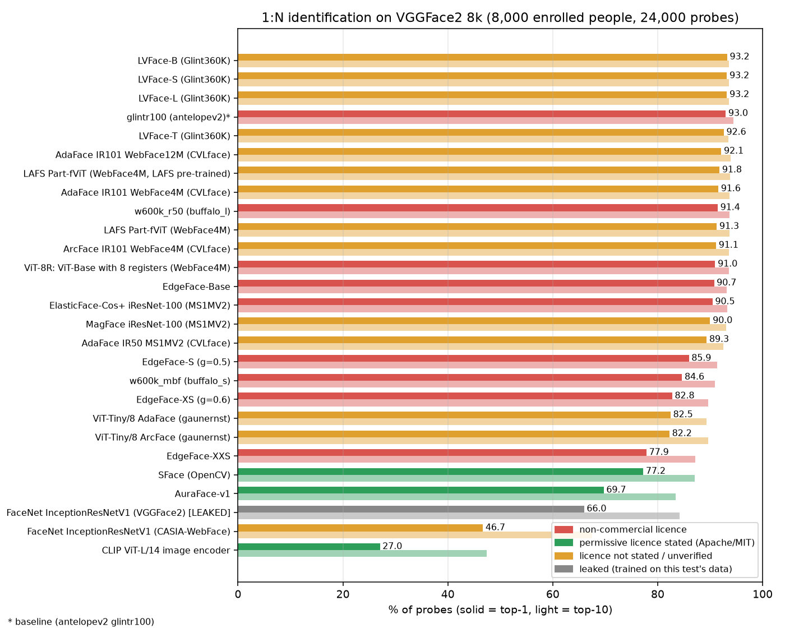
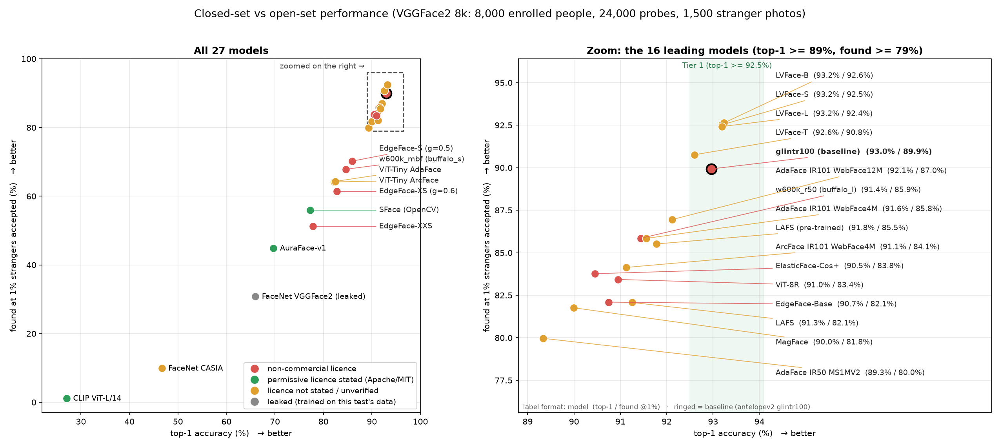
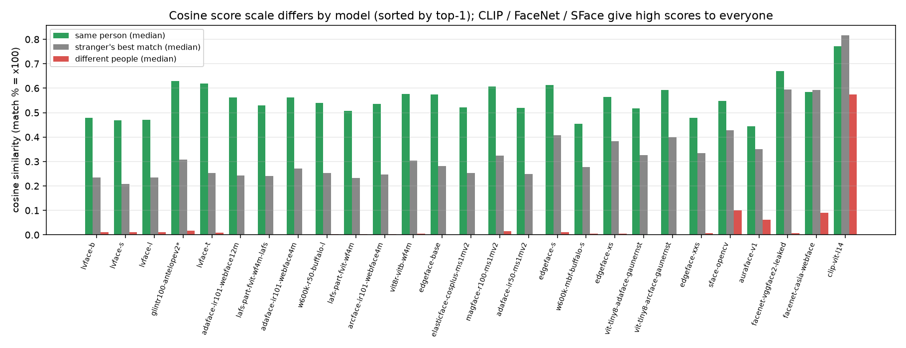
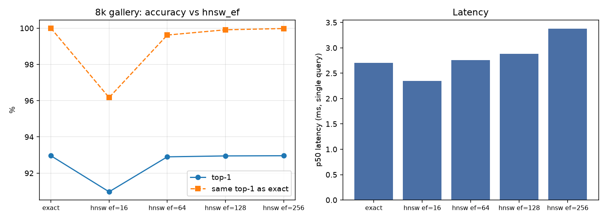
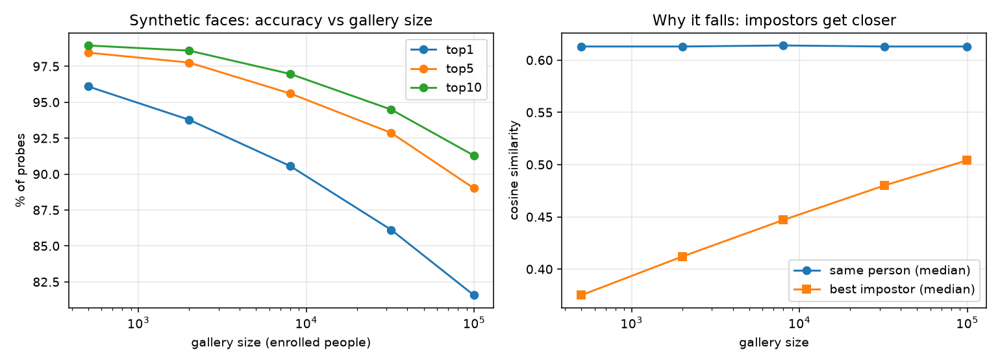
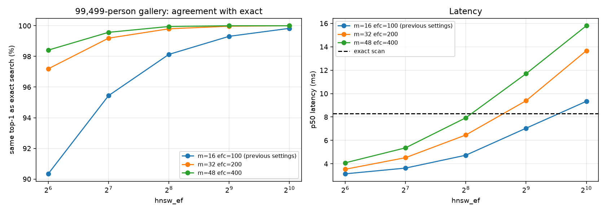
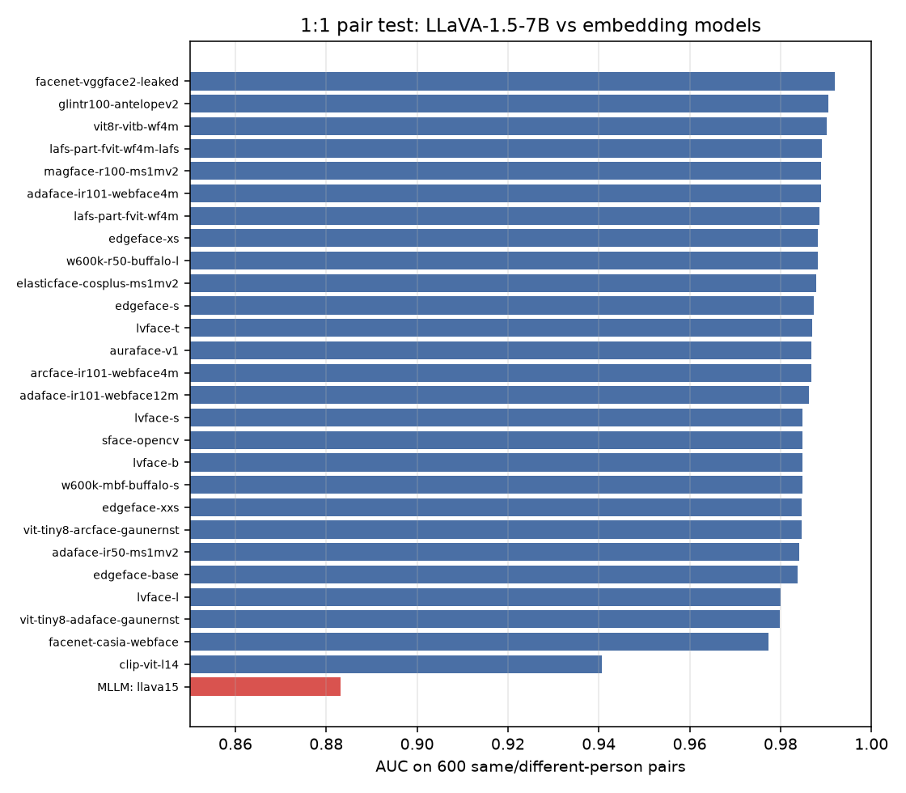
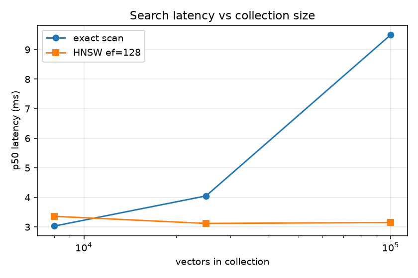

# Benchmarking 1:N face recognition

Open-weight face-embedding models compared on a **1:N identification** task (find a person among many enrolled people), searched with exact cosine search and **Qdrant**
(exact scan vs **HNSW**). Includes per-model folders with code and results, experiments on HNSW, gallery scale, latency and multimodal LLMs, and the pipeline code.

**Headline:** on VGGFace2 (8,000 enrolled people, 24,000 probes) the top group is **LVFace-B** (93.24%), **LVFace-S** (93.19%), **LVFace-L** (93.19%), **glintr100 (antelopev2)** (92.96%), **LVFace-T** (92.60%).
`antelopev2`'s `glintr100` (the baseline) is already in the top tier; the best ByteDance LVFace models match or marginally beat it on top-1 and open-set, but not on verification EER.

**Decision analysis** (top-K, cosine scores, confident-wrong rates, latency and product decisions): [product/ANALYSIS.md](product/ANALYSIS.md).



## Key findings
1. **Tier 1 is a near-tie.** LVFace-B 93.24%, LVFace-S 93.19%, LVFace-L 93.19%, glintr100 92.96%, LVFace-T 92.60%: gaps of a few tenths of a point are within noise for one random split.
2. **The baseline is still the best at verification** (EER 3.57%, TAR@FAR 0.1% 94.3%) and in the deeper ranks (top-5 94.05%, top-10 94.38%); LVFace is better at the open-set metric (found @1% unknown-accept).
3. **Bigger and better-trained wins, with diminishing returns:** LVFace-T to -B gains under 1 point of top-1; small/mobile models give up 10-25 points.
4. **The commercially licensed models are the weakest** (AuraFace 69.71%, SFace 77.24%); the strongest are non-commercial or have unverified weight licences.
5. **Face-specific models vastly beat general-purpose ones:** CLIP ViT-L/14 image features reach 27.05% top-1; LLaVA-1.5-7B is far behind on a same/different-person pair test (see [experiments](#experiments)).
6. **HNSW needs tuning at scale:** `m=16, ef_construct=100` matches exact search on 8k real faces for `hnsw_ef >= 128`, but lost about 4 points of top-1 on a 99,499-person synthetic gallery. A heavier build (`m=32, ef_construct=200`) restores it (99.2% agreement with exact at `hnsw_ef=128`, 4.5 ms vs 8.3 ms exact) for about 2x the build time; settings that agree with exact search on 99.8%+ of probes are only about 5-22% faster than an exact scan at 100k (see [experiments](#experiments)).
7. **Accuracy falls with gallery size** (synthetic faces: 96% top-1 at 500 people to 82% at 99,499) because impostors get closer, not because same-person similarity drops.
8. **The IJB-C leaderboard models we could run land in Tier 2** (LAFS 91.8%, ViT-8R 91.0%, ElasticFace-Cos+ 90.5%, MagFace 90.0%) and rank in the same order as their published IJB-C scores; none beats Tier 1 (see [leaderboard coverage](#coverage-of-the-public-ijb-c-leaderboard)).
9. **Cosine scores are model-specific.** The median same-person cosine ranges from 0.44 to 0.63 across models, and the cosine threshold for the same error rate differs (glintr100 0.43 vs LVFace-B 0.31 at 1% stranger-accept); `glintr100` has the best same/different-person separation (d' 4.76). Thresholds must be tuned per model (see [cosine scores](#cosine-similarity-scores)).

## Results: all 27 models
Sorted by top-1. *Found @1%* = share of enrolled probes correctly identified when the threshold is set so that only 1% of never-enrolled photos are accepted. *TAR @ FAR* is 1:1 verification
(true accepts at a fixed false-accept rate). Tiers: 1 = top-1 >= 92.5%, 2 = 90-92.5%, 3 = 80-90%, 4 = below 80%. Per-model detail is in each folder.

| # | Model | Top-1 | Top-5 | Top-10 | Found @1% unknown-accept | TAR @ FAR 0.1% | EER | Tier | Licence |
|--:|---|--:|--:|--:|--:|--:|--:|---|---|
| 1 | [LVFace-B (Glint360K)](models/lvface-b/) | 93.24% | 93.56% | 93.63% | 92.6% | 93.5% | 5.55% | Tier 1 | MIT stated; weights unverified |
| 2 | [LVFace-S (Glint360K)](models/lvface-s/) | 93.19% | 93.53% | 93.62% | 92.5% | 93.5% | 5.13% | Tier 1 | MIT stated; weights unverified |
| 3 | [LVFace-L (Glint360K)](models/lvface-l/) | 93.19% | 93.56% | 93.60% | 92.4% | 93.5% | 5.55% | Tier 1 | MIT stated; weights unverified |
| 4 | [glintr100 (antelopev2)](models/glintr100-antelopev2/) **(baseline)** | 92.96% | 94.05% | 94.38% | 89.9% | 94.3% | 3.57% | Tier 1 | Non-commercial (InsightFace) |
| 5 | [LVFace-T (Glint360K)](models/lvface-t/) | 92.60% | 93.27% | 93.48% | 90.8% | 93.4% | 4.87% | Tier 1 | MIT stated; weights unverified |
| 6 | [AdaFace IR101 WebFace12M](models/adaface-ir101-webface12m/) | 92.12% | 93.49% | 93.90% | 87.0% | 93.7% | 4.17% | Tier 2 | Not stated (dataset terms) |
| 7 | [LAFS Part-fViT (WebFace4M, LAFS pre-trained)](models/lafs-part-fvit-wf4m-lafs/) | 91.78% | 93.37% | 93.79% | 85.5% | 93.5% | 4.17% | Tier 2 | MIT (repo); WebFace4M terms apply |
| 8 | [AdaFace IR101 WebFace4M](models/adaface-ir101-webface4m/) | 91.56% | 93.28% | 93.67% | 85.8% | 93.6% | 4.06% | Tier 2 | Not stated (dataset terms) |
| 9 | [w600k_r50 (buffalo_l)](models/w600k-r50-buffalo-l/) | 91.44% | 93.33% | 93.64% | 85.9% | 93.5% | 4.17% | Tier 2 | Non-commercial (InsightFace) |
| 10 | [LAFS Part-fViT (WebFace4M)](models/lafs-part-fvit-wf4m/) | 91.25% | 93.30% | 93.70% | 82.1% | 93.5% | 4.28% | Tier 2 | MIT (repo); WebFace4M terms apply |
| 11 | [ArcFace IR101 WebFace4M](models/arcface-ir101-webface4m/) | 91.13% | 93.22% | 93.62% | 84.1% | 93.5% | 4.28% | Tier 2 | Not stated (dataset terms) |
| 12 | [ViT-8R: ViT-Base with 8 registers (WebFace4M)](models/vit8r-vitb-wf4m/) | 90.95% | 92.94% | 93.56% | 83.4% | 93.3% | 4.06% | Tier 2 | CC BY-NC-SA 4.0 |
| 13 | [EdgeFace-Base](models/edgeface-base/) | 90.75% | 92.77% | 93.17% | 82.1% | 93.0% | 4.39% | Tier 2 | CC BY-NC-SA 4.0 |
| 14 | [ElasticFace-Cos+ iResNet-100 (MS1MV2)](models/elasticface-cosplus-ms1mv2/) | 90.45% | 92.67% | 93.24% | 83.8% | 93.0% | 4.39% | Tier 2 | CC BY-NC-SA 4.0 |
| 15 | [MagFace iResNet-100 (MS1MV2)](models/magface-r100-ms1mv2/) | 90.00% | 92.38% | 93.00% | 81.8% | 92.8% | 4.39% | Tier 3 | Apache-2.0 (repo); MS1MV2 terms apply |
| 16 | [AdaFace IR50 MS1MV2](models/adaface-ir50-ms1mv2/) | 89.33% | 91.80% | 92.49% | 80.0% | 92.3% | 4.63% | Tier 3 | Not stated (dataset terms) |
| 17 | [EdgeFace-S (g=0.5)](models/edgeface-s/) | 85.95% | 90.31% | 91.33% | 70.2% | 91.1% | 4.51% | Tier 3 | CC BY-NC-SA 4.0 |
| 18 | [w600k_mbf (buffalo_s)](models/w600k-mbf-buffalo-s/) | 84.63% | 89.58% | 90.95% | 67.9% | 90.3% | 4.39% | Tier 3 | Non-commercial (InsightFace) |
| 19 | [EdgeFace-XS (g=0.6)](models/edgeface-xs/) | 82.75% | 88.29% | 89.66% | 61.4% | 89.3% | 4.75% | Tier 3 | CC BY-NC-SA 4.0 |
| 20 | [ViT-Tiny/8 AdaFace (gaunernst)](models/vit-tiny8-adaface-gaunernst/) | 82.45% | 87.92% | 89.28% | 64.3% | 89.0% | 5.13% | Tier 3 | Not stated |
| 21 | [ViT-Tiny/8 ArcFace (gaunernst)](models/vit-tiny8-arcface-gaunernst/) | 82.25% | 88.09% | 89.67% | 64.2% | 89.3% | 4.87% | Tier 3 | Not stated |
| 22 | [EdgeFace-XXS](models/edgeface-xxs/) | 77.86% | 85.30% | 87.20% | 51.2% | 86.6% | 5.41% | Tier 4 | CC BY-NC-SA 4.0 |
| 23 | [SFace (OpenCV)](models/sface-opencv/) | 77.24% | 84.88% | 87.00% | 55.9% | 85.8% | 5.13% | Tier 4 | Apache-2.0 |
| 24 | [AuraFace-v1](models/auraface-v1/) | 69.71% | 80.11% | 83.44% | 44.9% | 81.1% | 5.41% | Tier 4 | Apache-2.0 |
| 25 | [FaceNet InceptionResNetV1 (VGGFace2) [LEAKED]](models/facenet-vggface2-leaked/) | 65.97% | 79.83% | 84.19% | 30.8% | 82.7% | 3.48% | Not comparable | Code MIT; weights unverified |
| 26 | [FaceNet InceptionResNetV1 (CASIA-WebFace)](models/facenet-casia-webface/) | 46.67% | 61.44% | 67.46% | 9.9% | 57.4% | 7.39% | Tier 4 | Code MIT; weights unverified |
| 27 | [CLIP ViT-L/14 image encoder](models/clip-vit-l14/) | 27.05% | 41.02% | 47.35% | 1.2% | 22.3% | 11.79% | Tier 4 | MIT |

\* The leaked FaceNet row is trained on VGGFace2 itself, so it is not a fair score. FaceNet and CLIP numbers are also understated because they expect different input crops / are not face models.



Machine-readable: [`results/all_models.csv`](results/all_models.csv) · [`results/all_models.json`](results/all_models.json).

## Cosine similarity scores
Every model produces a cosine similarity between two faces (match % = cosine x 100). The values are **not probabilities and not comparable across models**: the same-person median ranges from 0.44 to 0.63, and the
threshold that gives a 1% stranger-accept rate is 0.29 for the most permissive model and 0.76 for the strictest. d' (separation) measures how far apart the same-person and different-person scores are; higher is better.

| Model | Same person (median) | Different people (median) | Stranger best match (median) | Separation d' | Cosine @ FAR 0.1% | Cosine @ 1% stranger-accept |
|---|--:|--:|--:|--:|--:|--:|
| [LVFace-B (Glint360K)](models/lvface-b/) | 0.478 | 0.010 | 0.234 | 4.50 | 0.197 | 0.311 |
| [LVFace-S (Glint360K)](models/lvface-s/) | 0.469 | 0.011 | 0.208 | 4.56 | 0.177 | 0.287 |
| [LVFace-L (Glint360K)](models/lvface-l/) | 0.471 | 0.011 | 0.235 | 4.43 | 0.199 | 0.315 |
| [glintr100 (antelopev2)](models/glintr100-antelopev2/) | 0.629 | 0.017 | 0.308 | 4.76 | 0.243 | 0.427 |
| [LVFace-T (Glint360K)](models/lvface-t/) | 0.619 | 0.008 | 0.252 | 4.25 | 0.206 | 0.355 |
| [AdaFace IR101 WebFace12M](models/adaface-ir101-webface12m/) | 0.562 | 0.001 | 0.243 | 4.11 | 0.189 | 0.360 |
| [LAFS Part-fViT (WebFace4M, LAFS pre-trained)](models/lafs-part-fvit-wf4m-lafs/) | 0.529 | 0.002 | 0.240 | 3.97 | 0.184 | 0.344 |
| [AdaFace IR101 WebFace4M](models/adaface-ir101-webface4m/) | 0.562 | 0.001 | 0.270 | 4.14 | 0.213 | 0.378 |
| [w600k_r50 (buffalo_l)](models/w600k-r50-buffalo-l/) | 0.539 | 0.003 | 0.253 | 4.06 | 0.199 | 0.357 |
| [LAFS Part-fViT (WebFace4M)](models/lafs-part-fvit-wf4m/) | 0.508 | 0.002 | 0.233 | 3.83 | 0.180 | 0.353 |
| [ArcFace IR101 WebFace4M](models/arcface-ir101-webface4m/) | 0.535 | 0.002 | 0.247 | 3.95 | 0.189 | 0.359 |
| [ViT-8R: ViT-Base with 8 registers (WebFace4M)](models/vit8r-vitb-wf4m/) | 0.577 | 0.004 | 0.304 | 4.13 | 0.242 | 0.413 |
| [EdgeFace-Base](models/edgeface-base/) | 0.575 | 0.001 | 0.281 | 3.96 | 0.218 | 0.407 |
| [ElasticFace-Cos+ iResNet-100 (MS1MV2)](models/elasticface-cosplus-ms1mv2/) | 0.521 | 0.001 | 0.252 | 3.90 | 0.196 | 0.349 |
| [MagFace iResNet-100 (MS1MV2)](models/magface-r100-ms1mv2/) | 0.606 | 0.015 | 0.325 | 4.05 | 0.259 | 0.441 |
| [AdaFace IR50 MS1MV2](models/adaface-ir50-ms1mv2/) | 0.520 | 0.000 | 0.250 | 3.70 | 0.193 | 0.363 |
| [EdgeFace-S (g=0.5)](models/edgeface-s/) | 0.613 | 0.012 | 0.408 | 3.98 | 0.337 | 0.528 |
| [w600k_mbf (buffalo_s)](models/w600k-mbf-buffalo-s/) | 0.454 | 0.005 | 0.278 | 3.57 | 0.225 | 0.382 |
| [EdgeFace-XS (g=0.6)](models/edgeface-xs/) | 0.563 | 0.006 | 0.383 | 3.74 | 0.315 | 0.516 |
| [ViT-Tiny/8 AdaFace (gaunernst)](models/vit-tiny8-adaface-gaunernst/) | 0.516 | 0.000 | 0.325 | 3.50 | 0.255 | 0.451 |
| [ViT-Tiny/8 ArcFace (gaunernst)](models/vit-tiny8-arcface-gaunernst/) | 0.592 | 0.001 | 0.400 | 3.78 | 0.321 | 0.528 |
| [EdgeFace-XXS](models/edgeface-xxs/) | 0.479 | 0.006 | 0.335 | 3.37 | 0.268 | 0.474 |
| [SFace (OpenCV)](models/sface-opencv/) | 0.548 | 0.101 | 0.429 | 3.47 | 0.375 | 0.527 |
| [AuraFace-v1](models/auraface-v1/) | 0.443 | 0.061 | 0.351 | 3.13 | 0.295 | 0.462 |
| [FaceNet InceptionResNetV1 (VGGFace2) [LEAKED]](models/facenet-vggface2-leaked/) | 0.670 | 0.007 | 0.595 | 4.05 | 0.501 | 0.738 |
| [FaceNet InceptionResNetV1 (CASIA-WebFace)](models/facenet-casia-webface/) | 0.584 | 0.090 | 0.593 | 3.06 | 0.553 | 0.763 |
| [CLIP ViT-L/14 image encoder](models/clip-vit-l14/) | 0.772 | 0.574 | 0.817 | 2.39 | 0.828 | 0.915 |



Per-model distributions are in each model folder (`cosine.json`, `cosine_distribution.png`); the table is also in [`results/cosine_stats.csv`](results/cosine_stats.csv).
**Per-photo detail:** for each of the 24,000 probe photos, the top-5 gallery photos with cosine and match % (and the rank of the right person) are in [`results/photo_top5/`](results/photo_top5/) for the six leading models.

## Coverage of the public IJB-C leaderboard
The [IJB-C verification leaderboard](https://scholarcompass.net/en/tasks/face-verification/benchmarks/ijb-c) (TAR @ FAR 1e-4, self-reported) lists 14 models. Our coverage:

| # | Leaderboard model | IJB-C TAR@FAR=1e-4 | Our status |
|--:|---|--:|---|
| 1 | LVFace-L (WebFace42M) | 98.06 | Not testable: the WebFace42M weights are not public. We ran **LVFace-L (Glint360K)**: 93.19% top-1 ([`lvface-l`](models/lvface-l/)) |
| 2 | WF42M ViT-L PFC-0.3 (InsightFace) | 98.00 | Not tested: weights only on Baidu / OneDrive (manual download) |
| 3 | Q-Margin | 97.78 | Not tested: no public code or weights |
| 4 | Part fViT (LAFS) | 97.48 | **Tested**: [`lafs-part-fvit-wf4m`](models/lafs-part-fvit-wf4m/) 91.25% top-1, with LAFS pre-training [`lafs-part-fvit-wf4m-lafs`](models/lafs-part-fvit-wf4m-lafs/) 91.78% top-1 |
| 5 | AdaFace R100 (WebFace4M) | 97.39 | **Tested** via the CVLface port: [`adaface-ir101-webface4m`](models/adaface-ir101-webface4m/) 91.56% top-1 (not verified identical to the official checkpoint) |
| 6 | ViT-8R | 97.37 | **Tested**: [`vit8r-vitb-wf4m`](models/vit8r-vitb-wf4m/) 90.95% top-1 |
| 7 | IBUG-500K R100 ArcFace | 97.27 | Not tested: weights not verified |
| 8 | Arc+DDLN (R100) | 96.96 | Not tested: no public code |
| 9 | ElasticFace-Cos+ | 96.65 | **Tested**: [`elasticface-cosplus-ms1mv2`](models/elasticface-cosplus-ms1mv2/) 90.45% top-1 |
| 10 | DQM-Face | 96.58 | Not tested: no public code |
| 11 | MagFace+ | 95.97 | **Tested** the released MagFace iResNet-100: [`magface-r100-ms1mv2`](models/magface-r100-ms1mv2/) 90.00% top-1 (the leaderboard's MagFace+ may be a different checkpoint) |
| 12 | FaceLiVT-M | 95.70 | Not tested: no code link |
| 13 | EdgeFace-S (gamma=0.5) | 95.63 | **Tested**: [`edgeface-s`](models/edgeface-s/) 85.95% top-1 |
| 14 | MinusFace | 94.70 | Not relevant (privacy-preserving method) |


The order of the models we could run (LAFS with pre-training > AdaFace WebFace4M > ViT-8R > ElasticFace > MagFace > EdgeFace-S) matches the order of their published IJB-C scores, which is a useful sanity check of this benchmark (the plain WebFace4M LAFS checkpoint, 91.25%, falls just below AdaFace, 91.56%).
The IJB-C scores are 1:1 verification from the papers and are not comparable in absolute terms with our 1:N numbers.

## Models (one folder each)
Each `models/<slug>/` has `README.md` (overview, licence, source links, full metrics, delta vs baseline, cosine similarity profile), `cosine.json`, `cosine_distribution.png`, `model.py` (definition + weight download) and `results.json`.

| Family | Models (folders) | Architecture | Licence class |
|---|---|---|---|
| LVFace (ByteDance) | [`lvface-b`](models/lvface-b/), [`lvface-s`](models/lvface-s/), [`lvface-l`](models/lvface-l/), [`lvface-t`](models/lvface-t/) | Vision Transformer, progressive cluster optimisation (ICCV 2025) | licence not stated / unverified |
| InsightFace ArcFace | [`glintr100-antelopev2`](models/glintr100-antelopev2/), [`w600k-r50-buffalo-l`](models/w600k-r50-buffalo-l/), [`w600k-mbf-buffalo-s`](models/w600k-mbf-buffalo-s/) | ResNet-100 (iResNet), ArcFace loss | non-commercial licence |
| CVLface (minchul) | [`adaface-ir101-webface12m`](models/adaface-ir101-webface12m/), [`adaface-ir101-webface4m`](models/adaface-ir101-webface4m/), [`arcface-ir101-webface4m`](models/arcface-ir101-webface4m/), [`adaface-ir50-ms1mv2`](models/adaface-ir50-ms1mv2/) | AdaFace, IResNet-101 | licence not stated / unverified |
| LAFS (CVPR 2024) | [`lafs-part-fvit-wf4m-lafs`](models/lafs-part-fvit-wf4m-lafs/), [`lafs-part-fvit-wf4m`](models/lafs-part-fvit-wf4m/) | Part-fViT (ViT-style, patch 8, built-in landmark branch) | licence not stated / unverified |
| ViT-8R (Fraunhofer IGD) | [`vit8r-vitb-wf4m`](models/vit8r-vitb-wf4m/) | Vision Transformer Base (patch 9) with 8 register tokens | non-commercial licence |
| EdgeFace (Idiap) | [`edgeface-base`](models/edgeface-base/), [`edgeface-s`](models/edgeface-s/), [`edgeface-xs`](models/edgeface-xs/), [`edgeface-xxs`](models/edgeface-xxs/) | EdgeNeXt-based hybrid CNN/Transformer with low-rank linear layers | non-commercial licence |
| ElasticFace | [`elasticface-cosplus-ms1mv2`](models/elasticface-cosplus-ms1mv2/) | iResNet-100, ElasticFace-Cos+ margin loss | non-commercial licence |
| MagFace | [`magface-r100-ms1mv2`](models/magface-r100-ms1mv2/) | iResNet-100, MagFace loss (embedding magnitude = quality) | licence not stated / unverified |
| timm-face (gaunernst) | [`vit-tiny8-adaface-gaunernst`](models/vit-tiny8-adaface-gaunernst/), [`vit-tiny8-arcface-gaunernst`](models/vit-tiny8-arcface-gaunernst/) | ViT-Tiny, patch 8, 112x112, AdaFace loss | licence not stated / unverified |
| SFace (OpenCV Zoo) | [`sface-opencv`](models/sface-opencv/) | SFace (see paper), 128-d output | permissive licence stated (Apache/MIT) |
| AuraFace (fal) | [`auraface-v1`](models/auraface-v1/) | ResNet-100, ArcFace loss (InsightFace-compatible ONNX) | permissive licence stated (Apache/MIT) |
| FaceNet (facenet-pytorch) | [`facenet-vggface2-leaked`](models/facenet-vggface2-leaked/), [`facenet-casia-webface`](models/facenet-casia-webface/) | Inception-ResNet-v1, 512-d | leaked (trained on this test's data), licence not stated / unverified |
| CLIP (OpenAI) | [`clip-vit-l14`](models/clip-vit-l14/) | ViT-L/14 image tower (the vision-encoder family used by LLaVA) | permissive licence stated (Apache/MIT) |

## Protocol and metrics
- **Data:** [VGGFace2 112x112](https://www.kaggle.com/datasets/yakhyokhuja/vggface2-112x112) aligned crops. Split in [`data/split_8k.csv`](data/split_8k.csv) (seed 42): **8,000 enrolled people with 1 photo each** (gallery),
  **24,000 probes** (3 other photos of the same people) and **1,500 photos of 500 people who are not enrolled** (open-set). Images are pre-aligned, so face detection / alignment is **not** part of this benchmark.
- **Search:** exact cosine over L2-normalised embeddings (numpy). The same embeddings were also searched in Qdrant to check the two agree.
- **Top-K:** the right person is within the first K results. **Found @ X% unknown-accept:** threshold chosen so X% of unknown-person photos are accepted; reports the share of enrolled probes whose top-1 is correct and above it.
  **TAR @ FAR:** 1:1 verification, genuine pairs (probe vs own gallery photo) against 200 random impostor pairs per probe. **EER:** where false-accept equals false-reject.
- **Not a probability:** similarity (cosine) scores are model-specific; do not reuse a threshold across models or datasets.

## Experiments
### HNSW vs exact search (8k gallery) · [`experiments/hnsw_vs_exact`](experiments/hnsw_vs_exact/)
| Search | Top-1 | Top-5 | Top-10 | Same top-1 as exact | p50 latency |
|---|--:|--:|--:|--:|--:|
| exact | 92.96% | 94.05% | 94.38% | 100.00% | 2.7 ms |
| hnsw ef=16 | 90.97% | 91.87% | 92.16% | 96.17% | 2.4 ms |
| hnsw ef=64 | 92.90% | 93.96% | 94.29% | 99.62% | 2.8 ms |
| hnsw ef=128 | 92.95% | 94.04% | 94.36% | 99.91% | 2.9 ms |
| hnsw ef=256 | 92.96% | 94.05% | 94.38% | 99.98% | 3.4 ms |



`ef` (`hnsw_ef`) is the candidate-list size at query time; `ef=128+` is practically identical to exact at this size. Qdrant only builds the HNSW graph above its `indexing_threshold`; below that it silently does exact search, so the index was forced (`indexing_threshold=1`).

### Synthetic faces, up to 99,499 enrolled people · [`experiments/synthetic_100k`](experiments/synthetic_100k/)
Synthetic dataset (3 folders, 5 images per identity): 1 enrolled image per identity, the other 4 as probes (397,996 probes), 500 identities held out as unknown. Embedded with the baseline; exact search.

| Gallery size | Top-1 | Top-5 | Top-10 | Median same-person sim | Median best-impostor sim | Unknown accepted @0.40 / 0.50 / 0.60 |
|--:|--:|--:|--:|--:|--:|--:|
| 500 | 96.1% | 98.5% | 99.0% | 0.613 | 0.375 | 30.3% / 1.1% / 0.0% |
| 2,000 | 93.8% | 97.8% | 98.6% | 0.613 | 0.412 | 61.4% / 4.7% / 0.1% |
| 8,000 | 90.6% | 95.6% | 97.0% | 0.614 | 0.447 | 85.7% / 13.8% / 0.4% |
| 32,000 | 86.1% | 92.9% | 94.5% | 0.613 | 0.48 | 96.8% / 34.0% / 1.3% |
| 99,499 | 81.6% | 89.0% | 91.3% | 0.613 | 0.504 | 99.0% / 53.4% / 2.9% |



Top-1 / top-5 / top-10 at full size: **81.7% / 89.6% / 91.8%**. Unknown synthetic people are accepted far more easily than real ones at the same threshold, so thresholds tuned on one dataset do not transfer.
**HNSW at 100k (Qdrant, 10,000-probe sample, m=16, ef_construct=100):**

| Search | Top-1 | Same top-1 as exact | p50 latency |
|---|--:|--:|--:|
| exact | 82.0% | 100.0% | 8.7 ms |
| hnsw_ef16 | 58.5% | 70.6% | 2.6 ms |
| hnsw_ef64 | 73.7% | 90.0% | 3.0 ms |
| hnsw_ef128 | 78.0% | 95.3% | 3.7 ms |
| hnsw_ef256 | 80.3% | 98.1% | 4.8 ms |

With these settings HNSW lost accuracy at 100k (e.g. `ef=128`: about 4 points of top-1). Heavier settings are tested in the next section.

### Heavier HNSW build settings at 99,499 people · [`experiments/hnsw_tuning`](experiments/hnsw_tuning/)
Same synthetic gallery and 10,000-probe sample, rebuilt in Qdrant with different `m` / `ef_construct` and searched at `hnsw_ef` 64-1024 (exact scan: **82.05% top-1, 8.3 ms**).

| Build settings | `hnsw_ef` | Same top-1 as exact | Top-1 | p50 latency | Build time |
|---|--:|--:|--:|--:|--:|
| m=16 efc=100 (previous settings) | 128 | 95.44% | 78.20% | 3.63 ms | 58 s |
| m=16 efc=100 (previous settings) | 512 | 99.31% | 81.45% | 7.04 ms | 58 s |
| m=32 efc=200 | 128 | 99.19% | 81.30% | 4.52 ms | 124 s |
| m=32 efc=200 | 256 | 99.80% | 81.85% | 6.46 ms | 124 s |
| m=48 efc=400 | 128 | 99.57% | 81.67% | 5.36 ms | 220 s |
| m=48 efc=400 | 256 | 99.95% | 82.01% | 7.93 ms | 220 s |



- The loss at 100k came mostly from the light build settings: `m=32, ef_construct=200` at `ef=128` is within 0.75 points of exact top-1 and agrees with it on 99.2% of probes.
- Accuracy can also be bought back with a larger `hnsw_ef` on the old build, but at `ef=1024` its latency (9.34 ms) is no better than the exact scan.
- Cost: build time grows with the settings (58 s -> 124 s -> 220 s here). At ~100k vectors near-exact HNSW is only modestly faster than an exact scan; the large speed advantage should appear at much bigger collections (not measured).
- `default_segment_number=1` did **not** reduce Qdrant's segment count (2 segments in every run), so the effect of segment count is not isolated; those rows are near-duplicates of the default builds.
- Caveats: synthetic faces, one build per setting, single queries over local HTTP in a Colima VM.

### Multimodal LLM and general-purpose encoder on pairs · [`experiments/mllm_pairs`](experiments/mllm_pairs/)
LLaVA-1.5-7B (4-bit, MLX) asked "same person?" on 600 sampled pairs (300 same / 300 different), scored by the Yes-vs-No probability, compared with the embedding models on the **same pairs**.

| Model | AUC | Best accuracy | Found @ 10% false-accept | Found @ 1% false-accept |
|---|--:|--:|--:|--:|
| glintr100-antelopev2 | 0.990 | 98.2% | 98.0% | 97.0% |
| adaface-ir101-webface4m | 0.989 | 98.0% | 98.0% | 96.3% |
| facenet-casia-webface | 0.977 | 93.2% | 92.7% | 83.7% |
| MLLM: llava15 | 0.883 | 81.3% | 65.0% | 40.3% |



Small sample (600 pairs; "found @1% false-accept" rests on ~3 impostors) and random (easy) impostors; LLaVA answered "Yes" on every pair, so only its score carries signal. CogVLM was not run (needs an NVIDIA-class GPU).

### Latency and scale · [`experiments/latency_scaling`](experiments/latency_scaling/)
| Vectors | Exact scan p50 | HNSW ef=128 p50 |
|--:|--:|--:|
| 8,000 | 3.03 ms | 3.36 ms |
| 25,000 | 4.05 ms | 3.12 ms |
| 100,000 | 9.5 ms | 3.15 ms |



25k and 100k collections are padded with random vectors: latency only. Exact scan grows linearly with collection size, HNSW stays nearly flat. Single-image embedding of the baseline takes ~94 ms on CPU (p50), so it dominates the request at these sizes.

## Pipeline and reports
- [`pipeline/facematch.py`](pipeline/facematch.py): enroll / search / verify using SCRFD + glintr100 (InsightFace `FaceAnalysis`) and Qdrant. [`pipeline/dedupe.py`](pipeline/dedupe.py): top-5 cross-ID duplicate search (the full run on the real data was **not completed**).
- [`docs/how-it-works.html`](docs/how-it-works.html): visual explainer (detection, alignment, embeddings, cosine, Qdrant, exact vs HNSW, interactive HNSW demo). Download and open in a browser.
- [`reports/`](reports/): `FaceMatch_Analysis.xlsx` and `FaceMatch_Dashboard.html` with their generator scripts. They now include the 21-model comparison (Excel sheets *Model Benchmark*, *Pair Test*, *Synthetic 100k*; a dashboard section), while the remaining sheets/charts (photo-wise top-5 detail, thresholds, failure analysis, HNSW / latency) analyse the **baseline model**.
  The Excel file contains VGGFace2 thumbnails (private repo only). The generators read the local run folders, so they are records of how the files were made, not portable scripts.

## Reproduce
```bash
pip install -r requirements.txt
export VGGFACE2_ROOT=/path/to/vggface2_112x112          # folder with id_XXXX/ sub-folders
python -m benchmark.run --list                          # model slugs
python -m benchmark.run glintr100-antelopev2            # one model (downloads weights into weights/)
python -m benchmark.run --all && python -m benchmark.aggregate
```
Notes: ONNX models use CoreML (Apple Silicon) or CUDA if present, otherwise CPU; accelerators change embeddings very slightly (cosine >= 0.9995 vs CPU in our check). Run times on an M2 Pro range from seconds
(EdgeFace-XXS) to about two hours (LVFace-B on CPU; the larger LVFace-L and the PyTorch models run on the GPU via MPS in 5-10 minutes). The refactored code was checked against the original run for EdgeFace-XXS, glintr100, SFace and LVFace-T (identical metrics, see [verification](#verification)).

## Limitations and caveats
- **VGGFace2 is clean and pre-aligned: the easy case.** Real ID-photo-vs-selfie data is harder; thresholds and rankings may change. Evaluating on real data is the next step.
- **One random split / seed.** The Tier 1 order is not statistically reliable; confidence intervals and multi-seed runs are not done.
- **Possible training-data overlap:** models trained on WebFace, MS1M or Glint360K may share identities with VGGFace2 (not verifiable). Models trained on VGGFace2 itself are marked leaked.
- **Licensing:** the strongest models are research / non-commercial (InsightFace weights, EdgeFace CC BY-NC-SA); LVFace and CVLface licences for the weights are unverified; the commercially licensed ones (AuraFace, SFace) scored lowest. Check before production use.
- **Only 1 enrolled photo per person;** averaging several enrolment photos was not tested. No liveness / anti-spoofing is included.
- **Untested:** InsightFace WebFace42M R100/R200/ViT-L models (weights only on Baidu / OneDrive, not scriptable), LVFace-L trained on WebFace42M (weights not public), TransFace, TopoFR, the leaderboard entries without public code (Q-Margin, Arc+DDLN, DQM-Face, FaceLiVT), CogVLM, other MLLMs.

## Roadmap
1. Run the best models on the real ID-photo-vs-selfie data and tune thresholds there.
2. HNSW at 1M+ vectors (where the speed advantage should appear); multi-seed repeats of the top models.
3. WebFace42M / TransFace / TopoFR models if weights can be obtained; commercial-licence options.

## Verification
`python -m benchmark.run <slug> --out /tmp/verify` was run through the refactored code for four models and compared with the original run: 

| Model | Top-1 (original / refactored) | Found @1% | EER | All six key metrics |
|---|--:|--:|--:|---|
| `glintr100-antelopev2` | 92.96% / 92.96% | 89.9% / 89.9% | 3.57% / 3.57% | identical |
| `lvface-t` | 92.60% / 92.60% | 90.8% / 90.8% | 4.87% / 4.87% | identical |
| `sface-opencv` | 77.24% / 77.24% | 55.9% / 55.9% | 5.13% / 5.13% | identical |
| `edgeface-xxs` | 77.86% / 77.86% | 51.2% / 51.2% | 5.41% / 5.41% | identical |


The two long-running experiment scripts were adapted to repo-relative paths after their reported runs and then **smoke-tested in their repo form**: `synth_100k.py` on a 3,000-identity slice (2,500 enrolled: 93.0% top-1; Qdrant exact search identical to the numpy search on all probes) and `mllm_pairs.py` on the first 12 pairs (same pairs, scores identical to the original run). The full 100-minute / 40-minute runs were not repeated.

## Licence of this repository
The code, documents, results and figures in this repository are available for **educational, non-commercial use only** under the [Educational Use License](LICENSE) (a custom licence, not an OSI open-source licence; commercial use needs the copyright holder's written permission). This does **not** cover third-party models, weights or datasets: they are not redistributed here and keep their own licences (see each model folder; several are non-commercial / research-only). `reports/FaceMatch_Analysis.xlsx` also contains thumbnails from the VGGFace2 dataset, which are not covered by this licence: remove that file before any public release.

## Repository layout
```
benchmark/          shared protocol, evaluation, loaders, CLI (run.py, aggregate.py)
data/split_8k.csv   the 8k split (relative paths)
models/<slug>/      README.md, model.py, results.json  (one per model)
results/            all_models.csv/json, figures/, experiment summaries
experiments/        hnsw_vs_exact, hnsw_tuning, synthetic_100k, mllm_pairs, latency_scaling
pipeline/           enroll/search/verify + duplicate search scripts
docs/               how-it-works.html
reports/            Excel report, dashboard and their generators (baseline model)
```
