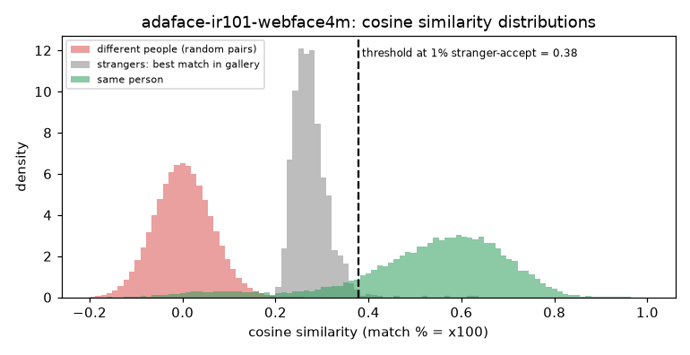

# AdaFace IR101 WebFace4M (CVLface)

**Rank 8 of 27 by top-1 · Tier 2** · [back to the benchmark](../../README.md)

## Overview
| | |
|---|---|
| Family | CVLface (minchul) |
| Architecture | AdaFace, IResNet-101 |
| Parameters | n/a (not measured) |
| Embedding size | 512-d |
| Weights file | n/a |
| Training data | WebFace4M |
| Licence | model card: 'follow the license of the training dataset' |
| Preprocessing | PyTorch, RGB, (x/255-0.5)/0.5, 112x112 |
| Weights / model card | <https://huggingface.co/minchul/cvlface_adaface_ir101_webface4m> |
| Code | <https://github.com/mk-minchul/CVLface> |
| Paper | <https://arxiv.org/abs/2204.00964> |

Needs transformers==4.44.2, fvcore, omegaconf, einops. Run in its own process (CVLface models share a `models` package name).

## Results (VGGFace2 8k protocol, exact search)
| Metric | Value | vs baseline (antelopev2 glintr100) |
|---|--:|--:|
| Top-1 | 91.56% | -1.40 pts |
| Top-5 | 93.28% | -0.78 pts |
| Top-10 | 93.67% | -0.71 pts |
| Found @ 1% unknown-accept | 85.85% | -4.08 pts |
| Found @ 5% unknown-accept | 88.65% | -3.27 pts |
| 1:1 TAR @ FAR 0.1% | 93.56% | -0.70 pts |
| 1:1 TAR @ FAR 0.01% | 91.96% | -1.34 pts |
| EER (lower is better, so + means worse) | 4.06% | +0.49 pts |
| Median similarity, same person | 0.562 | -0.067 |
| Median best-impostor similarity | 0.270 | -0.038 |
| Throughput during the run | 137 img/s | not comparable across models (different backends: CoreML / CPU / MPS) |

Raw numbers: [`results.json`](results.json). Similarity scores have a different scale for each model, so thresholds do not transfer between models.

## Cosine similarity profile
Cosine similarity of the L2-normalised embeddings (match % = cosine x 100). It is **not a probability** and the scale is specific to this model.

| Score group | median | 5th pct | 95th pct |
|---|--:|--:|--:|
| Same person (test photo vs its enrolled photo) | 0.562 | 0.145 | 0.749 |
| Different people (random pairs) | 0.001 | -0.098 | 0.104 |
| Stranger's best match in the gallery (never-enrolled photo) | 0.270 | 0.227 | 0.340 |

Separation d' = **4.14** (higher = same-person and different-person scores are further apart).

| Operating point | Cosine threshold |
|---|--:|
| 1:1 verification, false-accept rate 1% / 0.1% / 0.01% | 0.151 / 0.213 / 0.272 |
| 1:N open-set, 1% / 5% / 10% of strangers accepted | 0.378 / 0.340 / 0.320 |



## Run it
```bash
python -m benchmark.run adaface-ir101-webface4m
```
Model definition and weight download: [`model.py`](model.py). Shared loader code: [`benchmark/loaders.py`](../../benchmark/loaders.py), [`benchmark/common.py`](../../benchmark/common.py).
Weights are not committed (size and licences); `model.py` downloads them into `weights/`.
