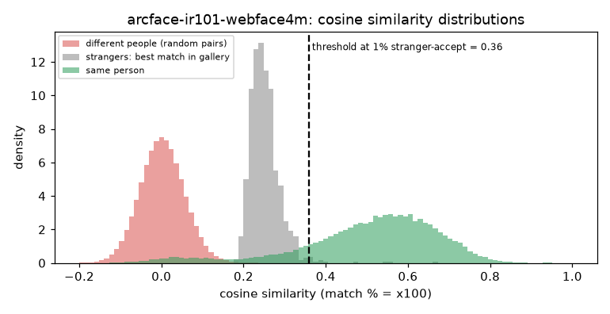

# ArcFace IR101 WebFace4M (CVLface)

**Rank 11 of 27 by top-1 · Tier 2** · [back to the benchmark](../../README.md)

## Overview
| | |
|---|---|
| Family | CVLface (minchul) |
| Architecture | ArcFace, IResNet-101 |
| Parameters | n/a (not measured) |
| Embedding size | 512-d |
| Weights file | n/a |
| Training data | WebFace4M |
| Licence | model card: 'follow the license of the training dataset' |
| Preprocessing | PyTorch, RGB, (x/255-0.5)/0.5, 112x112 |
| Weights / model card | <https://huggingface.co/minchul/cvlface_arcface_ir101_webface4m> |
| Code | <https://github.com/mk-minchul/CVLface> |
| Paper | <https://arxiv.org/abs/2204.00964> |

Needs transformers==4.44.2, fvcore, omegaconf, einops. Run in its own process (CVLface models share a `models` package name).

## Results (VGGFace2 8k protocol, exact search)
| Metric | Value | vs baseline (antelopev2 glintr100) |
|---|--:|--:|
| Top-1 | 91.13% | -1.83 pts |
| Top-5 | 93.22% | -0.83 pts |
| Top-10 | 93.62% | -0.76 pts |
| Found @ 1% unknown-accept | 84.14% | -5.79 pts |
| Found @ 5% unknown-accept | 87.99% | -3.93 pts |
| 1:1 TAR @ FAR 0.1% | 93.48% | -0.78 pts |
| 1:1 TAR @ FAR 0.01% | 91.70% | -1.60 pts |
| EER (lower is better, so + means worse) | 4.28% | +0.71 pts |
| Median similarity, same person | 0.535 | -0.094 |
| Median best-impostor similarity | 0.247 | -0.062 |
| Throughput during the run | 145 img/s | not comparable across models (different backends: CoreML / CPU / MPS) |

Raw numbers: [`results.json`](results.json). Similarity scores have a different scale for each model, so thresholds do not transfer between models.

## Cosine similarity profile
Cosine similarity of the L2-normalised embeddings (match % = cosine x 100). It is **not a probability** and the scale is specific to this model.

| Score group | median | 5th pct | 95th pct |
|---|--:|--:|--:|
| Same person (test photo vs its enrolled photo) | 0.535 | 0.123 | 0.729 |
| Different people (random pairs) | 0.002 | -0.085 | 0.092 |
| Stranger's best match in the gallery (never-enrolled photo) | 0.247 | 0.206 | 0.314 |

Separation d' = **3.95** (higher = same-person and different-person scores are further apart).

| Operating point | Cosine threshold |
|---|--:|
| 1:1 verification, false-accept rate 1% / 0.1% / 0.01% | 0.134 / 0.189 / 0.247 |
| 1:N open-set, 1% / 5% / 10% of strangers accepted | 0.359 / 0.314 / 0.294 |



## Run it
```bash
python -m benchmark.run arcface-ir101-webface4m
```
Model definition and weight download: [`model.py`](model.py). Shared loader code: [`benchmark/loaders.py`](../../benchmark/loaders.py), [`benchmark/common.py`](../../benchmark/common.py).
Weights are not committed (size and licences); `model.py` downloads them into `weights/`.
