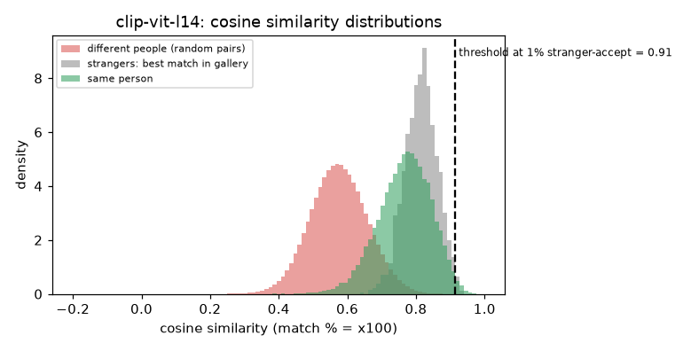

# CLIP ViT-L/14 image encoder

**Rank 27 of 27 by top-1 · Tier 4** · [back to the benchmark](../../README.md)

## Overview
| | |
|---|---|
| Family | CLIP (OpenAI) |
| Architecture | ViT-L/14 image tower (the vision-encoder family used by LLaVA) |
| Parameters | n/a (not measured) |
| Embedding size | 768-d |
| Weights file | n/a |
| Training data | web image-text pairs (general purpose, not face-specific) |
| Licence | MIT (OpenAI CLIP) |
| Preprocessing | transformers CLIPModel.get_image_features, RGB, CLIP mean/std, 224x224 |
| Weights / model card | <https://huggingface.co/openai/clip-vit-large-patch14> |
| Code | <https://github.com/openai/CLIP> |
| Paper | <https://arxiv.org/abs/2103.00020> |

Included to test the 'general-purpose encoder' claim: far below face-specific models.

## Results (VGGFace2 8k protocol, exact search)
| Metric | Value | vs baseline (antelopev2 glintr100) |
|---|--:|--:|
| Top-1 | 27.05% | -65.92 pts |
| Top-5 | 41.02% | -53.04 pts |
| Top-10 | 47.35% | -47.03 pts |
| Found @ 1% unknown-accept | 1.19% | -88.74 pts |
| Found @ 5% unknown-accept | 3.57% | -88.35 pts |
| 1:1 TAR @ FAR 0.1% | 22.26% | -72.00 pts |
| 1:1 TAR @ FAR 0.01% | 7.88% | -85.42 pts |
| EER (lower is better, so + means worse) | 11.79% | +8.22 pts |
| Median similarity, same person | 0.772 | +0.143 |
| Median best-impostor similarity | 0.816 | +0.508 |
| Throughput during the run | 14 img/s | not comparable across models (different backends: CoreML / CPU / MPS) |

Raw numbers: [`results.json`](results.json). Similarity scores have a different scale for each model, so thresholds do not transfer between models.

## Cosine similarity profile
Cosine similarity of the L2-normalised embeddings (match % = cosine x 100). It is **not a probability** and the scale is specific to this model.

| Score group | median | 5th pct | 95th pct |
|---|--:|--:|--:|
| Same person (test photo vs its enrolled photo) | 0.772 | 0.633 | 0.883 |
| Different people (random pairs) | 0.574 | 0.440 | 0.713 |
| Stranger's best match in the gallery (never-enrolled photo) | 0.817 | 0.737 | 0.890 |

Separation d' = **2.39** (higher = same-person and different-person scores are further apart).

| Operating point | Cosine threshold |
|---|--:|
| 1:1 verification, false-accept rate 1% / 0.1% / 0.01% | 0.769 / 0.828 / 0.870 |
| 1:N open-set, 1% / 5% / 10% of strangers accepted | 0.915 / 0.890 / 0.875 |



## Run it
```bash
python -m benchmark.run clip-vit-l14
```
Model definition and weight download: [`model.py`](model.py). Shared loader code: [`benchmark/loaders.py`](../../benchmark/loaders.py), [`benchmark/common.py`](../../benchmark/common.py).
Weights are not committed (size and licences); `model.py` downloads them into `weights/`.
