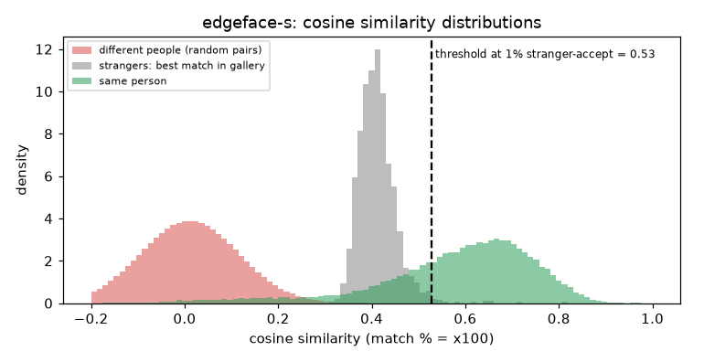

# EdgeFace-S (g=0.5)

**Rank 17 of 27 by top-1 · Tier 3** · [back to the benchmark](../../README.md)

## Overview
| | |
|---|---|
| Family | EdgeFace (Idiap) |
| Architecture | EdgeNeXt-based hybrid CNN/Transformer with low-rank linear layers |
| Parameters | 3.65M |
| Embedding size | 512-d |
| Weights file | 15 MB |
| Training data | WebFace260M subsets (EdgeFace-Base card: 12M + 4M subsets) |
| Licence | CC BY-NC-SA 4.0 (model card) |
| Preprocessing | PyTorch, RGB, (x/255-0.5)/0.5, 112x112 |
| Weights / model card | <https://huggingface.co/Idiap/EdgeFace-S-GAMMA> |
| Code | <https://github.com/otroshi/edgeface> |
| Paper | <https://huggingface.co/Idiap/EdgeFace-S-GAMMA> |

Edge-device family; 3.65M params and 306.12 MFLOPs per the model card. Code is fetched from github.com/otroshi/edgeface at run time (not vendored).

## Results (VGGFace2 8k protocol, exact search)
| Metric | Value | vs baseline (antelopev2 glintr100) |
|---|--:|--:|
| Top-1 | 85.95% | -7.02 pts |
| Top-5 | 90.31% | -3.74 pts |
| Top-10 | 91.33% | -3.05 pts |
| Found @ 1% unknown-accept | 70.23% | -19.70 pts |
| Found @ 5% unknown-accept | 78.40% | -13.52 pts |
| 1:1 TAR @ FAR 0.1% | 91.09% | -3.17 pts |
| 1:1 TAR @ FAR 0.01% | 86.95% | -6.35 pts |
| EER (lower is better, so + means worse) | 4.51% | +0.94 pts |
| Median similarity, same person | 0.613 | -0.016 |
| Median best-impostor similarity | 0.408 | +0.100 |
| Throughput during the run | 1141 img/s | not comparable across models (different backends: CoreML / CPU / MPS) |

Raw numbers: [`results.json`](results.json). Similarity scores have a different scale for each model, so thresholds do not transfer between models.

## Cosine similarity profile
Cosine similarity of the L2-normalised embeddings (match % = cosine x 100). It is **not a probability** and the scale is specific to this model.

| Score group | median | 5th pct | 95th pct |
|---|--:|--:|--:|
| Same person (test photo vs its enrolled photo) | 0.613 | 0.210 | 0.797 |
| Different people (random pairs) | 0.012 | -0.159 | 0.184 |
| Stranger's best match in the gallery (never-enrolled photo) | 0.408 | 0.359 | 0.479 |

Separation d' = **3.98** (higher = same-person and different-person scores are further apart).

| Operating point | Cosine threshold |
|---|--:|
| 1:1 verification, false-accept rate 1% / 0.1% / 0.01% | 0.256 / 0.337 / 0.406 |
| 1:N open-set, 1% / 5% / 10% of strangers accepted | 0.528 / 0.479 / 0.458 |



## Run it
```bash
python -m benchmark.run edgeface-s
```
Model definition and weight download: [`model.py`](model.py). Shared loader code: [`benchmark/loaders.py`](../../benchmark/loaders.py), [`benchmark/common.py`](../../benchmark/common.py).
Weights are not committed (size and licences); `model.py` downloads them into `weights/`.
