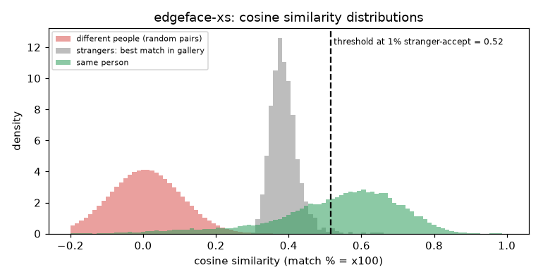

# EdgeFace-XS (g=0.6)

**Rank 19 of 27 by top-1 · Tier 3** · [back to the benchmark](../../README.md)

## Overview
| | |
|---|---|
| Family | EdgeFace (Idiap) |
| Architecture | EdgeNeXt-based hybrid CNN/Transformer with low-rank linear layers |
| Parameters | 1.77M |
| Embedding size | 512-d |
| Weights file | 7 MB |
| Training data | WebFace260M subsets (EdgeFace-Base card: 12M + 4M subsets) |
| Licence | CC BY-NC-SA 4.0 (model card) |
| Preprocessing | PyTorch, RGB, (x/255-0.5)/0.5, 112x112 |
| Weights / model card | <https://huggingface.co/Idiap/EdgeFace-XS-GAMMA> |
| Code | <https://github.com/otroshi/edgeface> |
| Paper | <https://huggingface.co/Idiap/EdgeFace-XS-GAMMA> |

Edge-device family; 1.77M params and 154.00 MFLOPs per the model card. Code is fetched from github.com/otroshi/edgeface at run time (not vendored).

## Results (VGGFace2 8k protocol, exact search)
| Metric | Value | vs baseline (antelopev2 glintr100) |
|---|--:|--:|
| Top-1 | 82.75% | -10.21 pts |
| Top-5 | 88.29% | -5.76 pts |
| Top-10 | 89.66% | -4.73 pts |
| Found @ 1% unknown-accept | 61.42% | -28.51 pts |
| Found @ 5% unknown-accept | 73.62% | -18.30 pts |
| 1:1 TAR @ FAR 0.1% | 89.29% | -4.97 pts |
| 1:1 TAR @ FAR 0.01% | 84.29% | -9.01 pts |
| EER (lower is better, so + means worse) | 4.75% | +1.18 pts |
| Median similarity, same person | 0.563 | -0.065 |
| Median best-impostor similarity | 0.383 | +0.074 |
| Throughput during the run | 1626 img/s | not comparable across models (different backends: CoreML / CPU / MPS) |

Raw numbers: [`results.json`](results.json). Similarity scores have a different scale for each model, so thresholds do not transfer between models.

## Cosine similarity profile
Cosine similarity of the L2-normalised embeddings (match % = cosine x 100). It is **not a probability** and the scale is specific to this model.

| Score group | median | 5th pct | 95th pct |
|---|--:|--:|--:|
| Same person (test photo vs its enrolled photo) | 0.563 | 0.177 | 0.766 |
| Different people (random pairs) | 0.006 | -0.155 | 0.168 |
| Stranger's best match in the gallery (never-enrolled photo) | 0.383 | 0.335 | 0.453 |

Separation d' = **3.74** (higher = same-person and different-person scores are further apart).

| Operating point | Cosine threshold |
|---|--:|
| 1:1 verification, false-accept rate 1% / 0.1% / 0.01% | 0.236 / 0.315 / 0.379 |
| 1:N open-set, 1% / 5% / 10% of strangers accepted | 0.516 / 0.453 / 0.435 |



## Run it
```bash
python -m benchmark.run edgeface-xs
```
Model definition and weight download: [`model.py`](model.py). Shared loader code: [`benchmark/loaders.py`](../../benchmark/loaders.py), [`benchmark/common.py`](../../benchmark/common.py).
Weights are not committed (size and licences); `model.py` downloads them into `weights/`.
