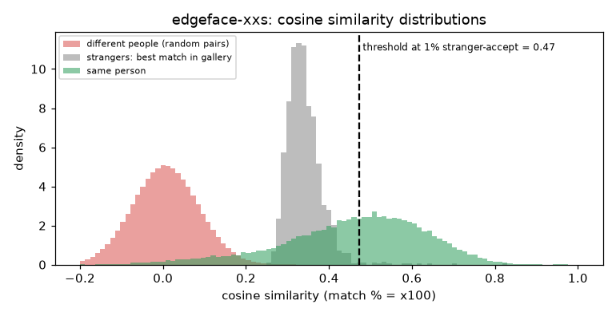

# EdgeFace-XXS

**Rank 22 of 27 by top-1 · Tier 4** · [back to the benchmark](../../README.md)

## Overview
| | |
|---|---|
| Family | EdgeFace (Idiap) |
| Architecture | EdgeNeXt-based hybrid CNN/Transformer with low-rank linear layers |
| Parameters | 1.24M |
| Embedding size | 512-d |
| Weights file | 5 MB |
| Training data | WebFace260M subsets (EdgeFace-Base card: 12M + 4M subsets) |
| Licence | CC BY-NC-SA 4.0 (model card) |
| Preprocessing | PyTorch, RGB, (x/255-0.5)/0.5, 112x112 |
| Weights / model card | <https://huggingface.co/Idiap/EdgeFace-XXS> |
| Code | <https://github.com/otroshi/edgeface> |
| Paper | <https://huggingface.co/Idiap/EdgeFace-XXS> |

Edge-device family; 1.24M params and 94.72 MFLOPs per the model card. Code is fetched from github.com/otroshi/edgeface at run time (not vendored).

## Results (VGGFace2 8k protocol, exact search)
| Metric | Value | vs baseline (antelopev2 glintr100) |
|---|--:|--:|
| Top-1 | 77.86% | -15.10 pts |
| Top-5 | 85.30% | -8.75 pts |
| Top-10 | 87.20% | -7.19 pts |
| Found @ 1% unknown-accept | 51.20% | -38.73 pts |
| Found @ 5% unknown-accept | 65.51% | -26.41 pts |
| 1:1 TAR @ FAR 0.1% | 86.56% | -7.70 pts |
| 1:1 TAR @ FAR 0.01% | 78.68% | -14.62 pts |
| EER (lower is better, so + means worse) | 5.41% | +1.84 pts |
| Median similarity, same person | 0.479 | -0.149 |
| Median best-impostor similarity | 0.335 | +0.027 |
| Throughput during the run | 2269 img/s | not comparable across models (different backends: CoreML / CPU / MPS) |

Raw numbers: [`results.json`](results.json). Similarity scores have a different scale for each model, so thresholds do not transfer between models.

## Cosine similarity profile
Cosine similarity of the L2-normalised embeddings (match % = cosine x 100). It is **not a probability** and the scale is specific to this model.

| Score group | median | 5th pct | 95th pct |
|---|--:|--:|--:|
| Same person (test photo vs its enrolled photo) | 0.479 | 0.127 | 0.706 |
| Different people (random pairs) | 0.006 | -0.123 | 0.139 |
| Stranger's best match in the gallery (never-enrolled photo) | 0.335 | 0.287 | 0.410 |

Separation d' = **3.37** (higher = same-person and different-person scores are further apart).

| Operating point | Cosine threshold |
|---|--:|
| 1:1 verification, false-accept rate 1% / 0.1% / 0.01% | 0.197 / 0.268 / 0.335 |
| 1:N open-set, 1% / 5% / 10% of strangers accepted | 0.474 / 0.410 / 0.391 |



## Run it
```bash
python -m benchmark.run edgeface-xxs
```
Model definition and weight download: [`model.py`](model.py). Shared loader code: [`benchmark/loaders.py`](../../benchmark/loaders.py), [`benchmark/common.py`](../../benchmark/common.py).
Weights are not committed (size and licences); `model.py` downloads them into `weights/`.
