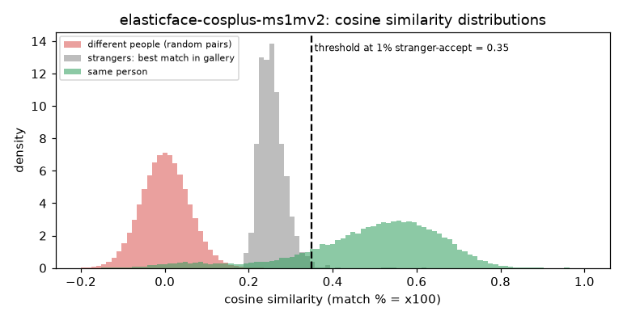

# ElasticFace-Cos+ iResNet-100 (MS1MV2)

**Rank 14 of 27 by top-1 · Tier 2** · [back to the benchmark](../../README.md)

## Overview
| | |
|---|---|
| Family | ElasticFace |
| Architecture | iResNet-100, ElasticFace-Cos+ margin loss |
| Parameters | n/a (not measured) |
| Embedding size | 512-d |
| Weights file | 261 MB |
| Training data | MS1MV2 |
| Licence | CC BY-NC-SA 4.0 (repo) |
| Preprocessing | PyTorch, RGB, (x/255-0.5)/0.5, 112x112 |
| Weights / model card | <https://github.com/fdbtrs/ElasticFace> |
| Code | <https://github.com/fdbtrs/ElasticFace> |

Listed on the IJB-C leaderboard (96.65). Architecture is the standard arcface_torch iResNet-100.

## Results (VGGFace2 8k protocol, exact search)
| Metric | Value | vs baseline (antelopev2 glintr100) |
|---|--:|--:|
| Top-1 | 90.45% | -2.51 pts |
| Top-5 | 92.67% | -1.38 pts |
| Top-10 | 93.24% | -1.14 pts |
| Found @ 1% unknown-accept | 83.77% | -6.16 pts |
| Found @ 5% unknown-accept | 87.21% | -4.71 pts |
| 1:1 TAR @ FAR 0.1% | 93.04% | -1.22 pts |
| 1:1 TAR @ FAR 0.01% | 90.95% | -2.35 pts |
| EER (lower is better, so + means worse) | 4.39% | +0.82 pts |
| Median similarity, same person | 0.521 | -0.107 |
| Median best-impostor similarity | 0.252 | -0.056 |
| Throughput during the run | 137 img/s | not comparable across models (different backends: CoreML / CPU / MPS) |

Raw numbers: [`results.json`](results.json). Similarity scores have a different scale for each model, so thresholds do not transfer between models.

## Cosine similarity profile
Cosine similarity of the L2-normalised embeddings (match % = cosine x 100). It is **not a probability** and the scale is specific to this model.

| Score group | median | 5th pct | 95th pct |
|---|--:|--:|--:|
| Same person (test photo vs its enrolled photo) | 0.521 | 0.121 | 0.714 |
| Different people (random pairs) | 0.001 | -0.090 | 0.096 |
| Stranger's best match in the gallery (never-enrolled photo) | 0.252 | 0.214 | 0.311 |

Separation d' = **3.90** (higher = same-person and different-person scores are further apart).

| Operating point | Cosine threshold |
|---|--:|
| 1:1 verification, false-accept rate 1% / 0.1% / 0.01% | 0.140 / 0.196 / 0.252 |
| 1:N open-set, 1% / 5% / 10% of strangers accepted | 0.349 / 0.311 / 0.295 |



## Run it
```bash
python -m benchmark.run elasticface-cosplus-ms1mv2
```
Model definition and weight download: [`model.py`](model.py). Shared loader code: [`benchmark/loaders.py`](../../benchmark/loaders.py), [`benchmark/common.py`](../../benchmark/common.py).
Weights are not committed (size and licences); `model.py` downloads them into `weights/`.
