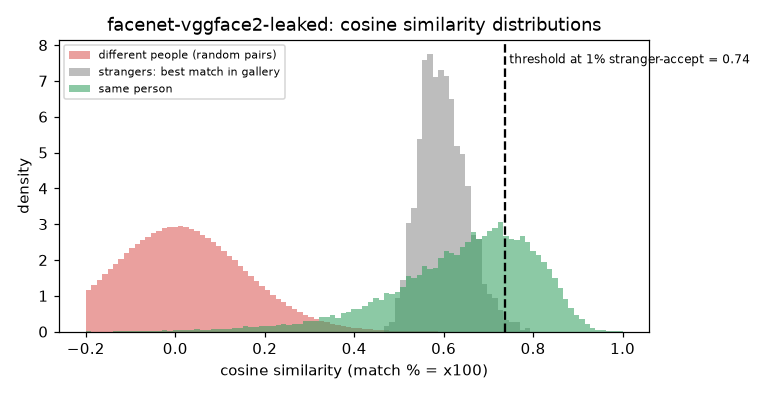

# FaceNet InceptionResNetV1 (VGGFace2) [LEAKED]

**Rank 25 of 27 by top-1 · Not comparable** · [back to the benchmark](../../README.md)

> **Leaked result.** LEAKED: trained on VGGFace2, so this score is inflated and must not be compared with the others. Shown for completeness only.

## Overview
| | |
|---|---|
| Family | FaceNet (facenet-pytorch) |
| Architecture | Inception-ResNet-v1, 512-d |
| Parameters | n/a (not measured) |
| Embedding size | 512-d |
| Weights file | n/a |
| Training data | VGGFace2 = the same data as this benchmark (LEAKED, not a fair score) |
| Licence | code MIT (facenet-pytorch); weights terms follow training data |
| Preprocessing | PyTorch, RGB, (x-127.5)/128 at 160x160 (upsampled) |
| Weights / model card | <https://github.com/timesler/facenet-pytorch> |
| Code | <https://github.com/timesler/facenet-pytorch> |
| Paper | <https://arxiv.org/abs/1503.03832> |

LEAKED: trained on VGGFace2, so this score is inflated and must not be compared with the others. Shown for completeness only.

## Results (VGGFace2 8k protocol, exact search)
| Metric | Value | vs baseline (antelopev2 glintr100) |
|---|--:|--:|
| Top-1 | 65.97% | -27.00 pts |
| Top-5 | 79.83% | -14.23 pts |
| Top-10 | 84.19% | -10.20 pts |
| Found @ 1% unknown-accept | 30.85% | -59.08 pts |
| Found @ 5% unknown-accept | 44.41% | -47.51 pts |
| 1:1 TAR @ FAR 0.1% | 82.73% | -11.53 pts |
| 1:1 TAR @ FAR 0.01% | 65.35% | -27.95 pts |
| EER (lower is better, so + means worse) | 3.48% | -0.09 pts |
| Median similarity, same person | 0.670 | +0.041 |
| Median best-impostor similarity | 0.595 | +0.286 |
| Throughput during the run | 523 img/s | not comparable across models (different backends: CoreML / CPU / MPS) |

Raw numbers: [`results.json`](results.json). Similarity scores have a different scale for each model, so thresholds do not transfer between models.

## Cosine similarity profile
Cosine similarity of the L2-normalised embeddings (match % = cosine x 100). It is **not a probability** and the scale is specific to this model.

| Score group | median | 5th pct | 95th pct |
|---|--:|--:|--:|
| Same person (test photo vs its enrolled photo) | 0.670 | 0.330 | 0.853 |
| Different people (random pairs) | 0.007 | -0.230 | 0.257 |
| Stranger's best match in the gallery (never-enrolled photo) | 0.595 | 0.520 | 0.689 |

Separation d' = **4.05** (higher = same-person and different-person scores are further apart).

| Operating point | Cosine threshold |
|---|--:|
| 1:1 verification, false-accept rate 1% / 0.1% / 0.01% | 0.370 / 0.501 / 0.605 |
| 1:N open-set, 1% / 5% / 10% of strangers accepted | 0.738 / 0.689 / 0.668 |



## Run it
```bash
python -m benchmark.run facenet-vggface2-leaked
```
Model definition and weight download: [`model.py`](model.py). Shared loader code: [`benchmark/loaders.py`](../../benchmark/loaders.py), [`benchmark/common.py`](../../benchmark/common.py).
Weights are not committed (size and licences); `model.py` downloads them into `weights/`.
