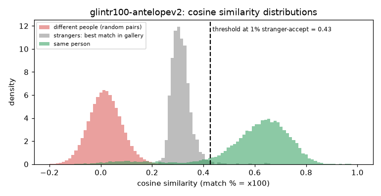

# glintr100 (antelopev2) [baseline]

**Rank 4 of 27 by top-1 · Tier 1** · [back to the benchmark](../../README.md)

## Overview
| | |
|---|---|
| Family | InsightFace ArcFace |
| Architecture | ResNet-100 (iResNet), ArcFace loss |
| Parameters | 65.16M |
| Embedding size | 512-d |
| Weights file | 261 MB |
| Training data | Glint360K (per InsightFace naming) |
| Licence | InsightFace model zoo: non-commercial research use |
| Preprocessing | ONNX, RGB, (x-127.5)/127.5, 112x112 |
| Weights / model card | <https://github.com/deepinsight/insightface/releases/download/v0.7/antelopev2.zip> |
| Code | <https://github.com/deepinsight/insightface> |
| Paper | <https://arxiv.org/abs/1801.07698> |

The reference model for the whole benchmark. Detector in the same pack (SCRFD) is not used: inputs are already aligned.

## Results (VGGFace2 8k protocol, exact search)
| Metric | Value | vs baseline (antelopev2 glintr100) |
|---|--:|--:|
| Top-1 | 92.96% | +0.00 pts |
| Top-5 | 94.05% | +0.00 pts |
| Top-10 | 94.38% | +0.00 pts |
| Found @ 1% unknown-accept | 89.93% | +0.00 pts |
| Found @ 5% unknown-accept | 91.92% | +0.00 pts |
| 1:1 TAR @ FAR 0.1% | 94.26% | +0.00 pts |
| 1:1 TAR @ FAR 0.01% | 93.30% | +0.00 pts |
| EER (lower is better, so + means worse) | 3.57% | +0.00 pts |
| Median similarity, same person | 0.629 | +0.000 |
| Median best-impostor similarity | 0.308 | +0.000 |
| Throughput during the run | 178 img/s | not comparable across models (different backends: CoreML / CPU / MPS) |

Raw numbers: [`results.json`](results.json). Similarity scores have a different scale for each model, so thresholds do not transfer between models.

## Cosine similarity profile
Cosine similarity of the L2-normalised embeddings (match % = cosine x 100). It is **not a probability** and the scale is specific to this model.

| Score group | median | 5th pct | 95th pct |
|---|--:|--:|--:|
| Same person (test photo vs its enrolled photo) | 0.629 | 0.205 | 0.775 |
| Different people (random pairs) | 0.017 | -0.084 | 0.124 |
| Stranger's best match in the gallery (never-enrolled photo) | 0.308 | 0.263 | 0.378 |

Separation d' = **4.76** (higher = same-person and different-person scores are further apart).

| Operating point | Cosine threshold |
|---|--:|
| 1:1 verification, false-accept rate 1% / 0.1% / 0.01% | 0.176 / 0.243 / 0.308 |
| 1:N open-set, 1% / 5% / 10% of strangers accepted | 0.427 / 0.378 / 0.357 |



Per-photo top-5 matches with cosine / match %: [`results/photo_top5/glintr100-antelopev2.csv`](../../results/photo_top5/glintr100-antelopev2.csv).

## Run it
```bash
python -m benchmark.run glintr100-antelopev2
```
Model definition and weight download: [`model.py`](model.py). Shared loader code: [`benchmark/loaders.py`](../../benchmark/loaders.py), [`benchmark/common.py`](../../benchmark/common.py).
Weights are not committed (size and licences); `model.py` downloads them into `weights/`.
