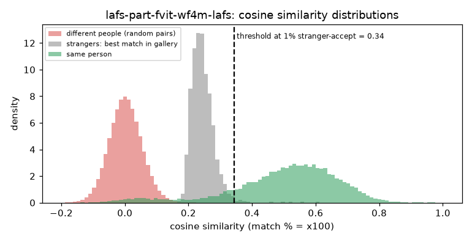

# LAFS Part-fViT (WebFace4M, LAFS pre-trained)

**Rank 7 of 27 by top-1 · Tier 2** · [back to the benchmark](../../README.md)

## Overview
| | |
|---|---|
| Family | LAFS (CVPR 2024) |
| Architecture | Part-fViT (ViT-style, patch 8, built-in landmark branch) |
| Parameters | n/a (not measured) |
| Embedding size | 768-d |
| Weights file | 180 MB |
| Training data | WebFace4M |
| Licence | MIT (repo); trained on WebFace4M, whose dataset terms apply |
| Preprocessing | PyTorch, RGB, x/255 - 0.5 (no division, as in the repo's IJB evaluation), 112x112 |
| Weights / model card | <https://github.com/szlbiubiubiu/lafs_cvpr2024> |
| Code | <https://github.com/szlbiubiubiu/lafs_cvpr2024> |

With LAFS self-supervised pre-training (README: IJB-C 97.58; the leaderboard lists LAFS at 97.48). Needs ipython, einops, timm. The checkpoint also holds the training classification head.

## Results (VGGFace2 8k protocol, exact search)
| Metric | Value | vs baseline (antelopev2 glintr100) |
|---|--:|--:|
| Top-1 | 91.78% | -1.18 pts |
| Top-5 | 93.37% | -0.69 pts |
| Top-10 | 93.79% | -0.60 pts |
| Found @ 1% unknown-accept | 85.52% | -4.41 pts |
| Found @ 5% unknown-accept | 88.97% | -2.95 pts |
| 1:1 TAR @ FAR 0.1% | 93.53% | -0.73 pts |
| 1:1 TAR @ FAR 0.01% | 92.19% | -1.11 pts |
| EER (lower is better, so + means worse) | 4.17% | +0.60 pts |
| Median similarity, same person | 0.529 | -0.100 |
| Median best-impostor similarity | 0.240 | -0.069 |
| Throughput during the run | 95 img/s | not comparable across models (different backends: CoreML / CPU / MPS) |

Raw numbers: [`results.json`](results.json). Similarity scores have a different scale for each model, so thresholds do not transfer between models.

## Cosine similarity profile
Cosine similarity of the L2-normalised embeddings (match % = cosine x 100). It is **not a probability** and the scale is specific to this model.

| Score group | median | 5th pct | 95th pct |
|---|--:|--:|--:|
| Same person (test photo vs its enrolled photo) | 0.529 | 0.121 | 0.729 |
| Different people (random pairs) | 0.002 | -0.080 | 0.088 |
| Stranger's best match in the gallery (never-enrolled photo) | 0.240 | 0.199 | 0.304 |

Separation d' = **3.97** (higher = same-person and different-person scores are further apart).

| Operating point | Cosine threshold |
|---|--:|
| 1:1 verification, false-accept rate 1% / 0.1% / 0.01% | 0.129 / 0.184 / 0.239 |
| 1:N open-set, 1% / 5% / 10% of strangers accepted | 0.344 / 0.304 / 0.286 |



## Run it
```bash
python -m benchmark.run lafs-part-fvit-wf4m-lafs
```
Model definition and weight download: [`model.py`](model.py). Shared loader code: [`benchmark/loaders.py`](../../benchmark/loaders.py), [`benchmark/common.py`](../../benchmark/common.py).
Weights are not committed (size and licences); `model.py` downloads them into `weights/`.
