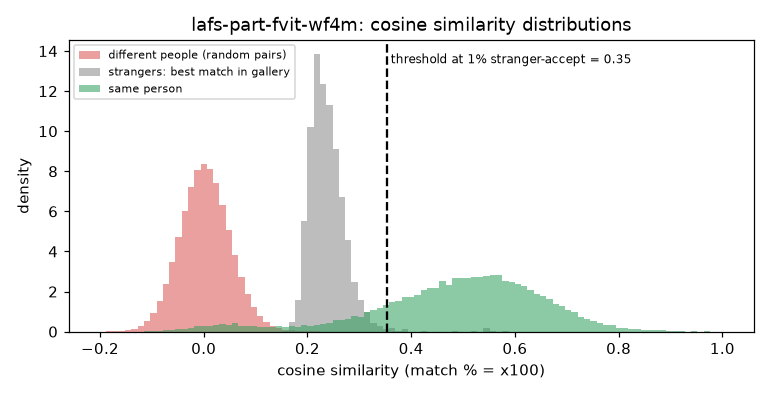

# LAFS Part-fViT (WebFace4M)

**Rank 10 of 27 by top-1 · Tier 2** · [back to the benchmark](../../README.md)

## Overview
| | |
|---|---|
| Family | LAFS (CVPR 2024) |
| Architecture | Part-fViT (ViT-style, patch 8, built-in landmark branch) |
| Parameters | n/a (not measured) |
| Embedding size | 768-d |
| Weights file | 901 MB |
| Training data | WebFace4M |
| Licence | MIT (repo); trained on WebFace4M, whose dataset terms apply |
| Preprocessing | PyTorch, RGB, x/255 - 0.5 (no division, as in the repo's IJB evaluation), 112x112 |
| Weights / model card | <https://github.com/szlbiubiubiu/lafs_cvpr2024> |
| Code | <https://github.com/szlbiubiubiu/lafs_cvpr2024> |

Supervised Part-fViT without LAFS pre-training (README: IJB-C TAR@FAR=1e-4 97.40). Needs ipython, einops, timm. The checkpoint also holds the training classification head.

## Results (VGGFace2 8k protocol, exact search)
| Metric | Value | vs baseline (antelopev2 glintr100) |
|---|--:|--:|
| Top-1 | 91.25% | -1.71 pts |
| Top-5 | 93.30% | -0.75 pts |
| Top-10 | 93.70% | -0.68 pts |
| Found @ 1% unknown-accept | 82.08% | -7.85 pts |
| Found @ 5% unknown-accept | 87.77% | -4.15 pts |
| 1:1 TAR @ FAR 0.1% | 93.47% | -0.79 pts |
| 1:1 TAR @ FAR 0.01% | 91.55% | -1.75 pts |
| EER (lower is better, so + means worse) | 4.28% | +0.71 pts |
| Median similarity, same person | 0.508 | -0.121 |
| Median best-impostor similarity | 0.233 | -0.076 |
| Throughput during the run | 98 img/s | not comparable across models (different backends: CoreML / CPU / MPS) |

Raw numbers: [`results.json`](results.json). Similarity scores have a different scale for each model, so thresholds do not transfer between models.

## Cosine similarity profile
Cosine similarity of the L2-normalised embeddings (match % = cosine x 100). It is **not a probability** and the scale is specific to this model.

| Score group | median | 5th pct | 95th pct |
|---|--:|--:|--:|
| Same person (test photo vs its enrolled photo) | 0.508 | 0.118 | 0.720 |
| Different people (random pairs) | 0.002 | -0.076 | 0.085 |
| Stranger's best match in the gallery (never-enrolled photo) | 0.233 | 0.195 | 0.297 |

Separation d' = **3.83** (higher = same-person and different-person scores are further apart).

| Operating point | Cosine threshold |
|---|--:|
| 1:1 verification, false-accept rate 1% / 0.1% / 0.01% | 0.125 / 0.180 / 0.238 |
| 1:N open-set, 1% / 5% / 10% of strangers accepted | 0.353 / 0.297 / 0.279 |



## Run it
```bash
python -m benchmark.run lafs-part-fvit-wf4m
```
Model definition and weight download: [`model.py`](model.py). Shared loader code: [`benchmark/loaders.py`](../../benchmark/loaders.py), [`benchmark/common.py`](../../benchmark/common.py).
Weights are not committed (size and licences); `model.py` downloads them into `weights/`.
