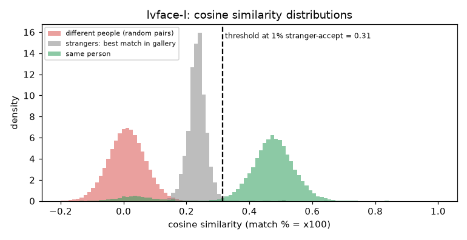

# LVFace-L (Glint360K)

**Rank 3 of 27 by top-1 · Tier 1** · [back to the benchmark](../../README.md)

## Overview
| | |
|---|---|
| Family | LVFace (ByteDance) |
| Architecture | Vision Transformer (ViT-L, patch 9), progressive cluster optimisation (ICCV 2025) |
| Parameters | n/a (not measured) |
| Embedding size | 512-d |
| Weights file | 1023 MB |
| Training data | Glint360K (same data as the antelopev2 baseline) |
| Licence | model card + code: MIT. The licence file covers the code; weights / Glint360K terms NOT verified |
| Preprocessing | PyTorch (official backbones/vit.py), RGB, (x/255-0.5)/0.5, 112x112 |
| Weights / model card | <https://huggingface.co/bytedance-research/LVFace> |
| Code | <https://github.com/bytedance/LVFace> |
| Paper | <https://arxiv.org/abs/2501.13420> |

Run through the official PyTorch code on the GPU (MPS) because the ONNX build runs on CPU and takes hours. The PyTorch loader was cross-checked against the ONNX model (cosine similarity of embeddings on 64 images).

## Results (VGGFace2 8k protocol, exact search)
| Metric | Value | vs baseline (antelopev2 glintr100) |
|---|--:|--:|
| Top-1 | 93.19% | +0.23 pts |
| Top-5 | 93.56% | -0.50 pts |
| Top-10 | 93.60% | -0.79 pts |
| Found @ 1% unknown-accept | 92.42% | +2.49 pts |
| Found @ 5% unknown-accept | 92.88% | +0.96 pts |
| 1:1 TAR @ FAR 0.1% | 93.45% | -0.81 pts |
| 1:1 TAR @ FAR 0.01% | 93.27% | -0.03 pts |
| EER (lower is better, so + means worse) | 5.55% | +1.98 pts |
| Median similarity, same person | 0.471 | -0.158 |
| Median best-impostor similarity | 0.235 | -0.073 |
| Throughput during the run | 55 img/s | not comparable across models (different backends: CoreML / CPU / MPS) |

Raw numbers: [`results.json`](results.json). Similarity scores have a different scale for each model, so thresholds do not transfer between models.

## Cosine similarity profile
Cosine similarity of the L2-normalised embeddings (match % = cosine x 100). It is **not a probability** and the scale is specific to this model.

| Score group | median | 5th pct | 95th pct |
|---|--:|--:|--:|
| Same person (test photo vs its enrolled photo) | 0.471 | 0.082 | 0.581 |
| Different people (random pairs) | 0.011 | -0.086 | 0.108 |
| Stranger's best match in the gallery (never-enrolled photo) | 0.235 | 0.186 | 0.282 |

Separation d' = **4.43** (higher = same-person and different-person scores are further apart).

| Operating point | Cosine threshold |
|---|--:|
| 1:1 verification, false-accept rate 1% / 0.1% / 0.01% | 0.150 / 0.199 / 0.239 |
| 1:N open-set, 1% / 5% / 10% of strangers accepted | 0.315 / 0.282 / 0.269 |



Per-photo top-5 matches with cosine / match %: [`results/photo_top5/lvface-l.csv`](../../results/photo_top5/lvface-l.csv).

## Run it
```bash
python -m benchmark.run lvface-l
```
Model definition and weight download: [`model.py`](model.py). Shared loader code: [`benchmark/loaders.py`](../../benchmark/loaders.py), [`benchmark/common.py`](../../benchmark/common.py).
Weights are not committed (size and licences); `model.py` downloads them into `weights/`.
