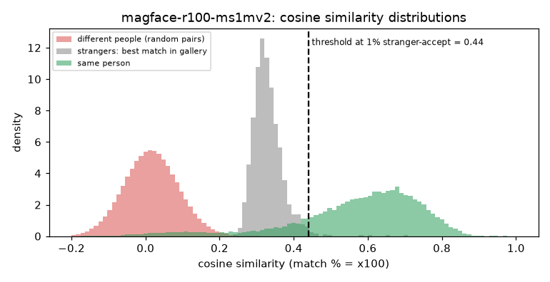

# MagFace iResNet-100 (MS1MV2)

**Rank 15 of 27 by top-1 · Tier 3** · [back to the benchmark](../../README.md)

## Overview
| | |
|---|---|
| Family | MagFace |
| Architecture | iResNet-100, MagFace loss (embedding magnitude = quality) |
| Parameters | n/a (not measured) |
| Embedding size | 512-d |
| Weights file | 283 MB |
| Training data | MS1MV2 |
| Licence | Apache-2.0 (repo); trained on MS1MV2, whose dataset terms apply |
| Preprocessing | PyTorch, BGR, x/255 with no mean/std (as in the MagFace repo), 112x112 |
| Weights / model card | <https://github.com/IrvingMeng/MagFace> |
| Code | <https://github.com/IrvingMeng/MagFace> |

Only the direction of the embedding is used (its norm is a quality score). Listed on the IJB-C leaderboard as MagFace+ (95.97).

## Results (VGGFace2 8k protocol, exact search)
| Metric | Value | vs baseline (antelopev2 glintr100) |
|---|--:|--:|
| Top-1 | 90.00% | -2.97 pts |
| Top-5 | 92.38% | -1.68 pts |
| Top-10 | 93.00% | -1.39 pts |
| Found @ 1% unknown-accept | 81.76% | -8.17 pts |
| Found @ 5% unknown-accept | 85.67% | -6.25 pts |
| 1:1 TAR @ FAR 0.1% | 92.78% | -1.48 pts |
| 1:1 TAR @ FAR 0.01% | 90.72% | -2.58 pts |
| EER (lower is better, so + means worse) | 4.39% | +0.82 pts |
| Median similarity, same person | 0.606 | -0.023 |
| Median best-impostor similarity | 0.325 | +0.016 |
| Throughput during the run | 145 img/s | not comparable across models (different backends: CoreML / CPU / MPS) |

Raw numbers: [`results.json`](results.json). Similarity scores have a different scale for each model, so thresholds do not transfer between models.

## Cosine similarity profile
Cosine similarity of the L2-normalised embeddings (match % = cosine x 100). It is **not a probability** and the scale is specific to this model.

| Score group | median | 5th pct | 95th pct |
|---|--:|--:|--:|
| Same person (test photo vs its enrolled photo) | 0.606 | 0.167 | 0.789 |
| Different people (random pairs) | 0.015 | -0.104 | 0.137 |
| Stranger's best match in the gallery (never-enrolled photo) | 0.325 | 0.277 | 0.401 |

Separation d' = **4.05** (higher = same-person and different-person scores are further apart).

| Operating point | Cosine threshold |
|---|--:|
| 1:1 verification, false-accept rate 1% / 0.1% / 0.01% | 0.192 / 0.259 / 0.322 |
| 1:N open-set, 1% / 5% / 10% of strangers accepted | 0.441 / 0.401 / 0.376 |



## Run it
```bash
python -m benchmark.run magface-r100-ms1mv2
```
Model definition and weight download: [`model.py`](model.py). Shared loader code: [`benchmark/loaders.py`](../../benchmark/loaders.py), [`benchmark/common.py`](../../benchmark/common.py).
Weights are not committed (size and licences); `model.py` downloads them into `weights/`.
