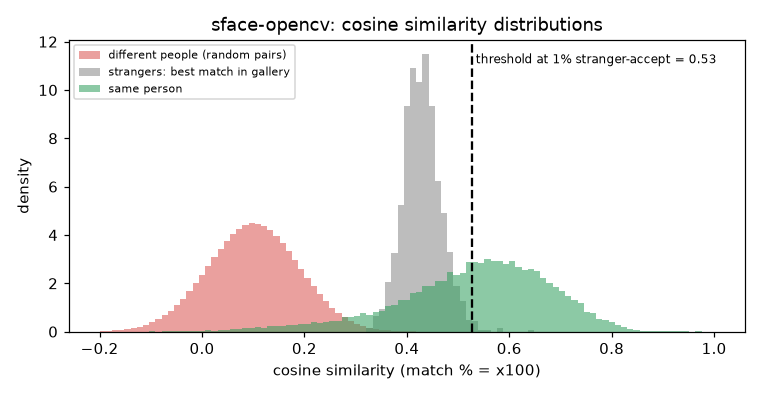

# SFace (OpenCV)

**Rank 23 of 27 by top-1 · Tier 4** · [back to the benchmark](../../README.md)

## Overview
| | |
|---|---|
| Family | SFace (OpenCV Zoo) |
| Architecture | SFace (see paper), 128-d output |
| Parameters | 9.67M |
| Embedding size | 128-d |
| Weights file | 39 MB |
| Training data | see SFace paper |
| Licence | Apache-2.0 (repo LICENSE) |
| Preprocessing | OpenCV cv2.FaceRecognizerSF.feature() on the aligned 112x112 BGR crop (OpenCV does its own preprocessing) |
| Weights / model card | <https://huggingface.co/opencv/face_recognition_sface> |
| Code | <https://github.com/opencv/opencv_zoo> |
| Paper | <https://arxiv.org/abs/2205.12010> |

128-d embedding (all others are 512-d). Commercially friendly licence, mid-to-low accuracy here.

## Results (VGGFace2 8k protocol, exact search)
| Metric | Value | vs baseline (antelopev2 glintr100) |
|---|--:|--:|
| Top-1 | 77.24% | -15.72 pts |
| Top-5 | 84.88% | -9.18 pts |
| Top-10 | 87.00% | -7.38 pts |
| Found @ 1% unknown-accept | 55.95% | -33.98 pts |
| Found @ 5% unknown-accept | 64.41% | -27.51 pts |
| 1:1 TAR @ FAR 0.1% | 85.76% | -8.50 pts |
| 1:1 TAR @ FAR 0.01% | 77.69% | -15.61 pts |
| EER (lower is better, so + means worse) | 5.13% | +1.57 pts |
| Median similarity, same person | 0.548 | -0.081 |
| Median best-impostor similarity | 0.429 | +0.120 |
| Throughput during the run | 153 img/s | not comparable across models (different backends: CoreML / CPU / MPS) |

Raw numbers: [`results.json`](results.json). Similarity scores have a different scale for each model, so thresholds do not transfer between models.

## Cosine similarity profile
Cosine similarity of the L2-normalised embeddings (match % = cosine x 100). It is **not a probability** and the scale is specific to this model.

| Score group | median | 5th pct | 95th pct |
|---|--:|--:|--:|
| Same person (test photo vs its enrolled photo) | 0.548 | 0.242 | 0.741 |
| Different people (random pairs) | 0.101 | -0.047 | 0.246 |
| Stranger's best match in the gallery (never-enrolled photo) | 0.429 | 0.370 | 0.493 |

Separation d' = **3.47** (higher = same-person and different-person scores are further apart).

| Operating point | Cosine threshold |
|---|--:|
| 1:1 verification, false-accept rate 1% / 0.1% / 0.01% | 0.307 / 0.375 / 0.432 |
| 1:N open-set, 1% / 5% / 10% of strangers accepted | 0.527 / 0.493 / 0.478 |



## Run it
```bash
python -m benchmark.run sface-opencv
```
Model definition and weight download: [`model.py`](model.py). Shared loader code: [`benchmark/loaders.py`](../../benchmark/loaders.py), [`benchmark/common.py`](../../benchmark/common.py).
Weights are not committed (size and licences); `model.py` downloads them into `weights/`.
