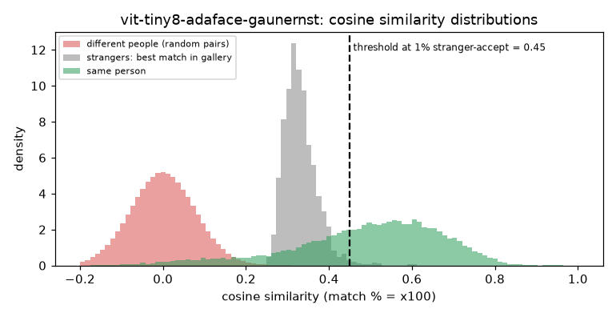

# ViT-Tiny/8 AdaFace (gaunernst)

**Rank 20 of 27 by top-1 · Tier 3** · [back to the benchmark](../../README.md)

## Overview
| | |
|---|---|
| Family | timm-face (gaunernst) |
| Architecture | ViT-Tiny, patch 8, 112x112, AdaFace loss |
| Parameters | 5.51M |
| Embedding size | 512-d |
| Weights file | n/a |
| Training data | MS1MV3 |
| Licence | not stated on the model card |
| Preprocessing | timm, RGB, mean/std 0.5 from the model's pretrained_cfg, 112x112 |
| Weights / model card | <https://huggingface.co/gaunernst/vit_tiny_patch8_112.adaface_ms1mv3> |
| Code | <https://github.com/gau-nernst/timm-face> |

Tiny ViT, ~5.5M params. Output is not normalised by the model: the harness L2-normalises.

## Results (VGGFace2 8k protocol, exact search)
| Metric | Value | vs baseline (antelopev2 glintr100) |
|---|--:|--:|
| Top-1 | 82.45% | -10.51 pts |
| Top-5 | 87.92% | -6.14 pts |
| Top-10 | 89.28% | -5.10 pts |
| Found @ 1% unknown-accept | 64.31% | -25.62 pts |
| Found @ 5% unknown-accept | 73.56% | -18.36 pts |
| 1:1 TAR @ FAR 0.1% | 89.00% | -5.26 pts |
| 1:1 TAR @ FAR 0.01% | 83.62% | -9.68 pts |
| EER (lower is better, so + means worse) | 5.13% | +1.57 pts |
| Median similarity, same person | 0.517 | -0.112 |
| Median best-impostor similarity | 0.325 | +0.017 |
| Throughput during the run | 859 img/s | not comparable across models (different backends: CoreML / CPU / MPS) |

Raw numbers: [`results.json`](results.json). Similarity scores have a different scale for each model, so thresholds do not transfer between models.

## Cosine similarity profile
Cosine similarity of the L2-normalised embeddings (match % = cosine x 100). It is **not a probability** and the scale is specific to this model.

| Score group | median | 5th pct | 95th pct |
|---|--:|--:|--:|
| Same person (test photo vs its enrolled photo) | 0.516 | 0.123 | 0.738 |
| Different people (random pairs) | 0.000 | -0.126 | 0.129 |
| Stranger's best match in the gallery (never-enrolled photo) | 0.325 | 0.280 | 0.400 |

Separation d' = **3.50** (higher = same-person and different-person scores are further apart).

| Operating point | Cosine threshold |
|---|--:|
| 1:1 verification, false-accept rate 1% / 0.1% / 0.01% | 0.186 / 0.255 / 0.323 |
| 1:N open-set, 1% / 5% / 10% of strangers accepted | 0.451 / 0.400 / 0.382 |



## Run it
```bash
python -m benchmark.run vit-tiny8-adaface-gaunernst
```
Model definition and weight download: [`model.py`](model.py). Shared loader code: [`benchmark/loaders.py`](../../benchmark/loaders.py), [`benchmark/common.py`](../../benchmark/common.py).
Weights are not committed (size and licences); `model.py` downloads them into `weights/`.
