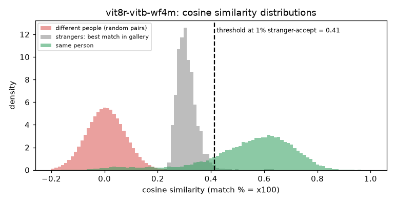

# ViT-8R: ViT-Base with 8 registers (WebFace4M)

**Rank 12 of 27 by top-1 · Tier 2** · [back to the benchmark](../../README.md)

## Overview
| | |
|---|---|
| Family | ViT-8R (Fraunhofer IGD) |
| Architecture | Vision Transformer Base (patch 9) with 8 register tokens |
| Parameters | n/a (not measured) |
| Embedding size | 512-d |
| Weights file | 455 MB |
| Training data | WebFace4M |
| Licence | CC BY-NC-SA 4.0 (repo) |
| Preprocessing | PyTorch (repo backbones/vit.py), RGB, (x/255-0.5)/0.5, 112x112 |
| Weights / model card | <https://owncloud.fraunhofer.de/index.php/s/wL8uH69nc25GUbY> |
| Code | <https://github.com/taharchettaoui/vit-fr-registers> |
| Paper | <https://ieeexplore.ieee.org/abstract/document/11556970> |

Appears on the IJB-C leaderboard as ViT-8R (97.37). Weights are hosted on a Fraunhofer OwnCloud share (it returned HTTP 503 for a while on first try). The repo README gives no usage code: the model is built with the repo's get_model('vit_b', num_register_token=8) and the checkpoint loads with zero missing / unexpected keys.

## Results (VGGFace2 8k protocol, exact search)
| Metric | Value | vs baseline (antelopev2 glintr100) |
|---|--:|--:|
| Top-1 | 90.95% | -2.01 pts |
| Top-5 | 92.94% | -1.11 pts |
| Top-10 | 93.56% | -0.82 pts |
| Found @ 1% unknown-accept | 83.43% | -6.50 pts |
| Found @ 5% unknown-accept | 87.11% | -4.81 pts |
| 1:1 TAR @ FAR 0.1% | 93.26% | -1.00 pts |
| 1:1 TAR @ FAR 0.01% | 91.43% | -1.87 pts |
| EER (lower is better, so + means worse) | 4.06% | +0.49 pts |
| Median similarity, same person | 0.577 | -0.052 |
| Median best-impostor similarity | 0.304 | -0.005 |
| Throughput during the run | 108 img/s | not comparable across models (different backends: CoreML / CPU / MPS) |

Raw numbers: [`results.json`](results.json). Similarity scores have a different scale for each model, so thresholds do not transfer between models.

## Cosine similarity profile
Cosine similarity of the L2-normalised embeddings (match % = cosine x 100). It is **not a probability** and the scale is specific to this model.

| Score group | median | 5th pct | 95th pct |
|---|--:|--:|--:|
| Same person (test photo vs its enrolled photo) | 0.577 | 0.171 | 0.763 |
| Different people (random pairs) | 0.004 | -0.114 | 0.125 |
| Stranger's best match in the gallery (never-enrolled photo) | 0.304 | 0.259 | 0.374 |

Separation d' = **4.13** (higher = same-person and different-person scores are further apart).

| Operating point | Cosine threshold |
|---|--:|
| 1:1 verification, false-accept rate 1% / 0.1% / 0.01% | 0.178 / 0.242 / 0.304 |
| 1:N open-set, 1% / 5% / 10% of strangers accepted | 0.413 / 0.374 / 0.356 |



## Run it
```bash
python -m benchmark.run vit8r-vitb-wf4m
```
Model definition and weight download: [`model.py`](model.py). Shared loader code: [`benchmark/loaders.py`](../../benchmark/loaders.py), [`benchmark/common.py`](../../benchmark/common.py).
Weights are not committed (size and licences); `model.py` downloads them into `weights/`.
