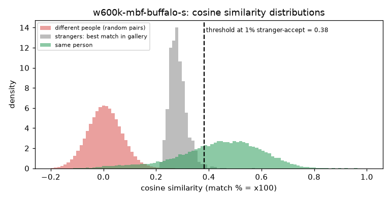

# w600k_mbf (buffalo_s)

**Rank 18 of 27 by top-1 · Tier 3** · [back to the benchmark](../../README.md)

## Overview
| | |
|---|---|
| Family | InsightFace ArcFace |
| Architecture | MobileFaceNet, ArcFace loss |
| Parameters | 3.4M |
| Embedding size | 512-d |
| Weights file | 14 MB |
| Training data | WebFace600K (per InsightFace naming) |
| Licence | InsightFace model zoo: non-commercial research use |
| Preprocessing | ONNX, RGB, (x-127.5)/127.5, 112x112 |
| Weights / model card | <https://github.com/deepinsight/insightface/releases/download/v0.7/buffalo_s.zip> |
| Code | <https://github.com/deepinsight/insightface> |
| Paper | <https://arxiv.org/abs/1801.07698> |

Small and fast. CoreML cannot run this model, the loader falls back to CPU automatically.

## Results (VGGFace2 8k protocol, exact search)
| Metric | Value | vs baseline (antelopev2 glintr100) |
|---|--:|--:|
| Top-1 | 84.63% | -8.33 pts |
| Top-5 | 89.58% | -4.48 pts |
| Top-10 | 90.95% | -3.44 pts |
| Found @ 1% unknown-accept | 67.86% | -22.07 pts |
| Found @ 5% unknown-accept | 75.31% | -16.61 pts |
| 1:1 TAR @ FAR 0.1% | 90.30% | -3.96 pts |
| 1:1 TAR @ FAR 0.01% | 84.82% | -8.48 pts |
| EER (lower is better, so + means worse) | 4.39% | +0.82 pts |
| Median similarity, same person | 0.454 | -0.174 |
| Median best-impostor similarity | 0.278 | -0.030 |
| Throughput during the run | 174 img/s | not comparable across models (different backends: CoreML / CPU / MPS) |

Raw numbers: [`results.json`](results.json). Similarity scores have a different scale for each model, so thresholds do not transfer between models.

## Cosine similarity profile
Cosine similarity of the L2-normalised embeddings (match % = cosine x 100). It is **not a probability** and the scale is specific to this model.

| Score group | median | 5th pct | 95th pct |
|---|--:|--:|--:|
| Same person (test photo vs its enrolled photo) | 0.454 | 0.133 | 0.670 |
| Different people (random pairs) | 0.005 | -0.099 | 0.113 |
| Stranger's best match in the gallery (never-enrolled photo) | 0.278 | 0.238 | 0.344 |

Separation d' = **3.57** (higher = same-person and different-person scores are further apart).

| Operating point | Cosine threshold |
|---|--:|
| 1:1 verification, false-accept rate 1% / 0.1% / 0.01% | 0.163 / 0.225 / 0.282 |
| 1:N open-set, 1% / 5% / 10% of strangers accepted | 0.382 / 0.344 / 0.327 |



## Run it
```bash
python -m benchmark.run w600k-mbf-buffalo-s
```
Model definition and weight download: [`model.py`](model.py). Shared loader code: [`benchmark/loaders.py`](../../benchmark/loaders.py), [`benchmark/common.py`](../../benchmark/common.py).
Weights are not committed (size and licences); `model.py` downloads them into `weights/`.
