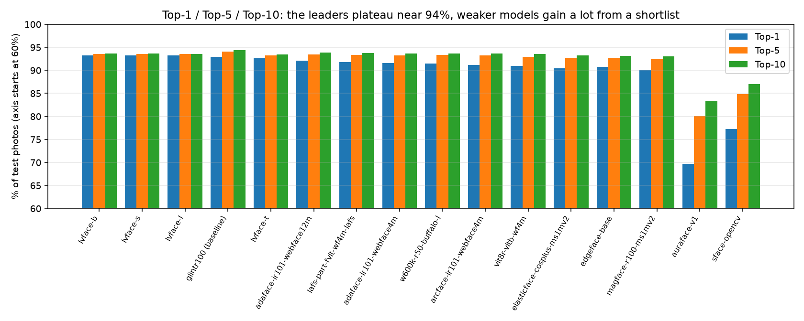
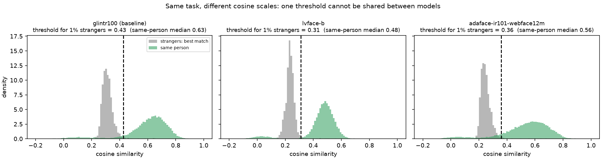
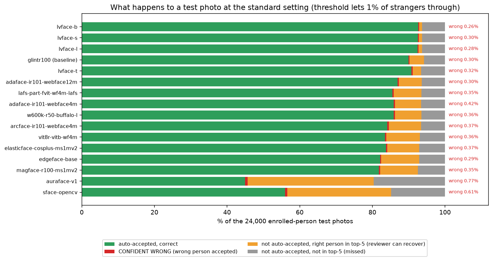
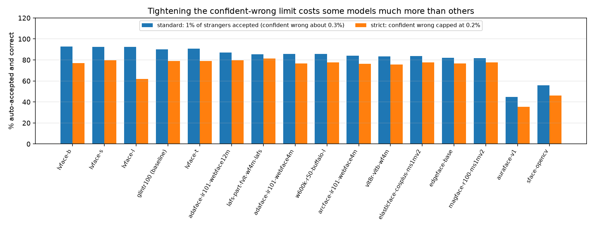

# Analysis and product decisions

What the benchmark means for a real system: which model, which thresholds, how many mistakes, and what has to be decided. It builds on the [27-model benchmark](../README.md)
(VGGFace2, 8,000 enrolled people with 1 photo each, 24,000 test photos of those people, 1,500 photos of 500 strangers; exact cosine search). Plain-language definitions are at the end of each section.
EER, TAR and the other verification metrics are left out here on purpose: this document is about **identification** (who is this?) and the decisions around it.

## 1. Summary: what we would decide

1. **The top is a tie, so choose on licence and risk, not on 0.2 points.** Five models sit within 0.7 points of top-1 (92.6% to 93.2%): LVFace-B/S/L/T and the `glintr100` baseline.
2. **About 5.8-6.6% of enrolled people are missed by every Tier 1 model, even with a top-5 shortlist.** That floor does not move with the model, so plan a fallback path (manual check, second factor, re-capture) for roughly 1 in 16 people. (Cause not verified by eye; a near-zero cluster of same-person scores in section 4 suggests mislabelled or very hard photos.)
3. **Confident wrong (the costly error) is about 0.3% for the Tier 1 models at the standard setting.** If it must be at most 0.2%, the ranking changes: **LAFS Part-fViT (WebFace4M, LAFS pre-trained)** keeps the most correct auto-accepts (81.2%); LVFace-B drops to 77.0% and LVFace-L to 62.0%. The top-1 leader is not the strict-setting leader.
4. **Cosine scores cannot be shared between models.** The same-person median runs from 0.44 to 0.63 among face models, and the threshold for the same error rate differs by model. Tune thresholds per model on held-out real data.
5. **Latency is dominated by embedding, not search** (about 94 ms per face on CPU vs 3-10 ms to search 100k faces). Search tuning only matters at larger scale.
6. **Licence is the gating decision.** The most accurate models are non-commercial or have unverified weight licences; the commercially licensed ones (AuraFace, SFace) are too weak to automate on their own. Settle the licence route before building on any of them.

## 2. Results: all 27 models
Tier by top-1: 1 = 92.5% or more, 2 = 90-92.5%, 3 = 80-90%, 4 = below 80%. *Found @1% strangers* = share of enrolled people correctly identified when the threshold only lets 1% of strangers' photos through.
*Top-5 gain* = how much a 5-result shortlist adds over the single best match.

| # | Model | Top-1 | Top-5 | Top-10 | Top-5 gain over Top-1 | Found @1% strangers | Tier | Licence |
|--:|---|--:|--:|--:|--:|--:|--:|---|
| 1 | LVFace-B (Glint360K) | 93.24% | 93.56% | 93.63% | +0.3 | 92.6% | 1 | Not stated / unverified |
| 2 | LVFace-L (Glint360K) | 93.19% | 93.56% | 93.60% | +0.4 | 92.4% | 1 | Not stated / unverified |
| 3 | LVFace-S (Glint360K) | 93.19% | 93.53% | 93.62% | +0.3 | 92.5% | 1 | Not stated / unverified |
| 4 | glintr100 (antelopev2) **(baseline)** | 92.96% | 94.05% | 94.38% | +1.1 | 89.9% | 1 | Non-commercial |
| 5 | LVFace-T (Glint360K) | 92.60% | 93.27% | 93.48% | +0.7 | 90.8% | 1 | Not stated / unverified |
| 6 | AdaFace IR101 WebFace12M | 92.12% | 93.49% | 93.90% | +1.4 | 87.0% | 2 | Not stated / unverified |
| 7 | LAFS Part-fViT (WebFace4M, LAFS pre-trained) | 91.78% | 93.37% | 93.79% | +1.6 | 85.5% | 2 | Not stated / unverified |
| 8 | AdaFace IR101 WebFace4M | 91.56% | 93.28% | 93.67% | +1.7 | 85.8% | 2 | Not stated / unverified |
| 9 | w600k_r50 (buffalo_l) | 91.44% | 93.33% | 93.64% | +1.9 | 85.9% | 2 | Non-commercial |
| 10 | LAFS Part-fViT (WebFace4M) | 91.25% | 93.30% | 93.70% | +2.0 | 82.1% | 2 | Not stated / unverified |
| 11 | ArcFace IR101 WebFace4M | 91.13% | 93.22% | 93.62% | +2.1 | 84.1% | 2 | Not stated / unverified |
| 12 | ViT-8R: ViT-Base with 8 registers (WebFace4M) | 90.95% | 92.94% | 93.56% | +2.0 | 83.4% | 2 | Non-commercial |
| 13 | EdgeFace-Base | 90.75% | 92.77% | 93.17% | +2.0 | 82.1% | 2 | Non-commercial |
| 14 | ElasticFace-Cos+ iResNet-100 (MS1MV2) | 90.45% | 92.67% | 93.24% | +2.2 | 83.8% | 2 | Non-commercial |
| 15 | MagFace iResNet-100 (MS1MV2) | 90.00% | 92.38% | 93.00% | +2.4 | 81.8% | 3 | Not stated / unverified |
| 16 | AdaFace IR50 MS1MV2 | 89.33% | 91.80% | 92.49% | +2.5 | 80.0% | 3 | Not stated / unverified |
| 17 | EdgeFace-S (g=0.5) | 85.95% | 90.31% | 91.33% | +4.4 | 70.2% | 3 | Non-commercial |
| 18 | w600k_mbf (buffalo_s) | 84.63% | 89.58% | 90.95% | +4.9 | 67.9% | 3 | Non-commercial |
| 19 | EdgeFace-XS (g=0.6) | 82.75% | 88.29% | 89.66% | +5.5 | 61.4% | 3 | Non-commercial |
| 20 | ViT-Tiny/8 AdaFace (gaunernst) | 82.45% | 87.92% | 89.28% | +5.5 | 64.3% | 3 | Not stated / unverified |
| 21 | ViT-Tiny/8 ArcFace (gaunernst) | 82.25% | 88.09% | 89.67% | +5.8 | 64.2% | 3 | Not stated / unverified |
| 22 | EdgeFace-XXS | 77.86% | 85.30% | 87.20% | +7.4 | 51.2% | 4 | Non-commercial |
| 23 | SFace (OpenCV) | 77.24% | 84.88% | 87.00% | +7.6 | 55.9% | 4 | Permissive (Apache/MIT) |
| 24 | AuraFace-v1 | 69.71% | 80.11% | 83.44% | +10.4 | 44.9% | 4 | Permissive (Apache/MIT) |
| 25 | FaceNet InceptionResNetV1 (VGGFace2) [LEAKED] | 65.97% | 79.83% | 84.19% | +13.9 | 30.8% | n/a (leaked) | Leaked (trained on this data) |
| 26 | FaceNet InceptionResNetV1 (CASIA-WebFace) | 46.67% | 61.44% | 67.46% | +14.8 | 9.9% | 4 | Not stated / unverified |
| 27 | CLIP ViT-L/14 image encoder | 27.05% | 41.02% | 47.35% | +14.0 | 1.2% | 4 | Permissive (Apache/MIT) |

**Reading it**
- **Tier 1** (top-1 92.6-93.2%): LVFace-B, -S, -L, `glintr100`, LVFace-T. LVFace-B/-S/-L have the best "found @1% strangers" (about 92-93% vs 90% for the baseline; LVFace-T 90.8%), but are not ahead at top-5/top-10.
- **LVFace-L adds nothing over -B or -S.** It is the slowest and ties on every number; there is no reason to run it.
- **LVFace-T** is a third of the baseline's file size (77 MB vs 261 MB) and sits in Tier 1 with 92.6% top-1.
- **Tier 2** (90-92%): AdaFace, `w600k_r50`, LAFS, ViT-8R, ElasticFace, MagFace, EdgeFace-Base: usable, a point or two behind.
- **Small and mobile models** (EdgeFace-S/XS/XXS, ViT-Tiny, `w600k_mbf`) lose 7-15 points of top-1 but gain a lot from a top-5 shortlist.
- **Commercially licensed** AuraFace (69.7%) and SFace (77.2%) are far behind. FaceNet (leaked) and CLIP are not comparable / not face models.

## 3. Top-K: what a shortlist buys

Top-K asks: is the right person among the first K results? K matters when a human (or a second check) looks at a shortlist instead of trusting the single best match.

| Model | Top-1 | Top-5 | Top-10 | Gain Top-1 to Top-5 |
|---|--:|--:|--:|--:|
| lvface-b | 93.2% | 93.6% | 93.6% | +0.3 |
| glintr100 (baseline) | 93.0% | 94.1% | 94.4% | +1.1 |
| adaface-ir101-webface12m | 92.1% | 93.5% | 93.9% | +1.4 |
| lafs-part-fvit-wf4m-lafs | 91.8% | 93.4% | 93.8% | +1.6 |
| edgeface-base | 90.7% | 92.8% | 93.2% | +2.0 |
| edgeface-s | 85.9% | 90.3% | 91.3% | +4.4 |
| sface-opencv | 77.2% | 84.9% | 87.0% | +7.6 |
| auraface-v1 | 69.7% | 80.1% | 83.4% | +10.4 |

- **For the leaders a shortlist adds little:** LVFace-B gains only +0.3 points, `glintr100` +1.1, AdaFace +1.4. When they miss, the right person is usually not near the top at all.
- **For weaker models it matters:** EdgeFace-S +4.4, SFace +7.6, AuraFace +10.4. A top-5 review step would rescue many of their misses (but at a cost in reviewer time).
- **Everything plateaus around 93.5-94.4% at top-10.** The remaining ~6% is the floor from the summary.

## 4. Cosine similarity: what the scores look like
Cosine similarity compares two face fingerprints (match % = cosine x 100). It is **not the probability of a match**, and each model has its own scale.
Three groups of scores matter: the **same person** (test photo vs its enrolled photo), **different people** (random pairs) and **strangers' best match** (a never-enrolled person's photo against the whole gallery: the highest score a stranger can reach).

| Model | Same person (median) | Different people (median) | Stranger's best match (median) | Separation d' | Cosine for 1% strangers |
|---|--:|--:|--:|--:|--:|
| LVFace-B (Glint360K) | 0.478 | 0.010 | 0.234 | 4.50 | 0.311 |
| LVFace-L (Glint360K) | 0.471 | 0.011 | 0.235 | 4.43 | 0.315 |
| LVFace-S (Glint360K) | 0.469 | 0.011 | 0.208 | 4.56 | 0.287 |
| glintr100 (antelopev2) | 0.629 | 0.017 | 0.308 | 4.76 | 0.427 |
| LVFace-T (Glint360K) | 0.619 | 0.008 | 0.252 | 4.25 | 0.355 |
| AdaFace IR101 WebFace12M | 0.562 | 0.001 | 0.243 | 4.11 | 0.360 |
| LAFS Part-fViT (WebFace4M, LAFS pre-trained) | 0.529 | 0.002 | 0.240 | 3.97 | 0.344 |
| AdaFace IR101 WebFace4M | 0.562 | 0.001 | 0.270 | 4.14 | 0.378 |
| w600k_r50 (buffalo_l) | 0.539 | 0.003 | 0.253 | 4.06 | 0.357 |
| LAFS Part-fViT (WebFace4M) | 0.508 | 0.002 | 0.233 | 3.83 | 0.353 |
| ArcFace IR101 WebFace4M | 0.535 | 0.002 | 0.247 | 3.95 | 0.359 |
| ViT-8R: ViT-Base with 8 registers (WebFace4M) | 0.577 | 0.004 | 0.304 | 4.13 | 0.413 |
| EdgeFace-Base | 0.575 | 0.001 | 0.281 | 3.96 | 0.407 |
| ElasticFace-Cos+ iResNet-100 (MS1MV2) | 0.521 | 0.001 | 0.252 | 3.90 | 0.349 |
| MagFace iResNet-100 (MS1MV2) | 0.606 | 0.015 | 0.325 | 4.05 | 0.441 |
| AdaFace IR50 MS1MV2 | 0.520 | 0.000 | 0.250 | 3.70 | 0.363 |
| EdgeFace-S (g=0.5) | 0.613 | 0.012 | 0.408 | 3.98 | 0.528 |
| w600k_mbf (buffalo_s) | 0.454 | 0.005 | 0.278 | 3.57 | 0.382 |
| EdgeFace-XS (g=0.6) | 0.563 | 0.006 | 0.383 | 3.74 | 0.516 |
| ViT-Tiny/8 AdaFace (gaunernst) | 0.516 | 0.000 | 0.325 | 3.50 | 0.451 |
| ViT-Tiny/8 ArcFace (gaunernst) | 0.592 | 0.001 | 0.400 | 3.78 | 0.528 |
| EdgeFace-XXS | 0.479 | 0.006 | 0.335 | 3.37 | 0.474 |
| SFace (OpenCV) | 0.548 | 0.101 | 0.429 | 3.47 | 0.527 |
| AuraFace-v1 | 0.443 | 0.061 | 0.351 | 3.13 | 0.462 |
| FaceNet InceptionResNetV1 (VGGFace2) [LEAKED] | 0.670 | 0.007 | 0.595 | 4.05 | 0.738 |
| FaceNet InceptionResNetV1 (CASIA-WebFace) | 0.584 | 0.090 | 0.593 | 3.06 | 0.763 |
| CLIP ViT-L/14 image encoder | 0.772 | 0.574 | 0.817 | 2.39 | 0.915 |

**Reading it**
- **Different people sit near 0 for almost every face model** (median 0.00-0.02). The exceptions are SFace (0.10), FaceNet CASIA (0.09), AuraFace (0.06) and CLIP (0.57): these models give unrelated faces noticeably high scores, which is a sign of weaker separation.
- **The risk is not random strangers but the best match among 8,000 people** (grey in the chart): its median is 0.2-0.4 for good models, and the threshold has to sit above it. That is why the 1%-strangers threshold is much higher than the different-people median.
- **Scales differ:** `glintr100` has a same-person median of 0.63 and needs a threshold of 0.43; LVFace-B has 0.48 and needs 0.31. Using one model's threshold on another gives the wrong error rate.
- **Separation d'** (how far apart same-person and different-people scores are) is best for `glintr100` (4.76), then LVFace-S (4.56) and -B (4.50); it is lowest for CLIP, FaceNet (CASIA) and AuraFace.
- **A small bump of "same person" scores sits near 0 in every chart**, right where different-people scores are: 3.9% of `glintr100`'s same-person scores, 6.3% of LVFace-B's and 5.5% of AdaFace's are below 0.15. Those test photos look like a different person to every model, which fits mislabelled or extremely hard photos and would explain the ~6% floor in section 1 (not verified by eye).
- **Per-photo detail:** top-5 matches with cosine / match % for each test photo are in [`results/photo_top5/`](../results/photo_top5/) (six leading models).

## 5. Confident wrong, and what happens to a photo
**Confident wrong** = the system accepts the wrong person (top-1 is someone else and the score is above the accept threshold). It is the costly error: a wrong person is treated as a match.
Below, every enrolled-person photo ends up in one of four outcomes at a chosen cosine threshold.

### 5.1 Standard setting: threshold lets 1% of strangers through

| Model | Cosine threshold | Auto-accepted, correct | **Confident wrong** | Right person in top-5 (review) | Missed |
|---|--:|--:|--:|--:|--:|
| lvface-b | 0.311 | 92.6% | 0.26% | 0.8% | 6.3% |
| lvface-s | 0.287 | 92.5% | 0.30% | 0.9% | 6.3% |
| lvface-l | 0.315 | 92.4% | 0.28% | 1.0% | 6.3% |
| glintr100 (baseline) | 0.427 | 89.9% | 0.30% | 4.0% | 5.8% |
| lvface-t | 0.355 | 90.8% | 0.32% | 2.3% | 6.6% |
| adaface-ir101-webface12m | 0.360 | 87.0% | 0.30% | 6.4% | 6.4% |
| lafs-part-fvit-wf4m-lafs | 0.344 | 85.5% | 0.35% | 7.7% | 6.5% |
| adaface-ir101-webface4m | 0.378 | 85.8% | 0.42% | 7.2% | 6.6% |
| w600k-r50-buffalo-l | 0.357 | 85.9% | 0.36% | 7.3% | 6.5% |
| arcface-ir101-webface4m | 0.359 | 84.1% | 0.37% | 8.9% | 6.6% |
| vit8r-vitb-wf4m | 0.413 | 83.4% | 0.36% | 9.3% | 6.9% |
| elasticface-cosplus-ms1mv2 | 0.349 | 83.8% | 0.37% | 8.7% | 7.1% |
| edgeface-base | 0.407 | 82.1% | 0.29% | 10.5% | 7.1% |
| magface-r100-ms1mv2 | 0.441 | 81.8% | 0.35% | 10.4% | 7.5% |
| auraface-v1 | 0.462 | 44.9% | 0.77% | 34.7% | 19.6% |
| sface-opencv | 0.527 | 55.9% | 0.61% | 28.6% | 14.9% |

- **Confident wrong is about 0.3% for the Tier 1 models** (0.26-0.32%) and up to 0.42% for the others in this table, so at this setting the leaders differ in *how many people they auto-accept*, not in how often they are confidently wrong.
- **LVFace auto-accepts the most** (92.6% for -B) and leaves almost nothing for a reviewer to recover (under 1%): its failures are far misses.
- **`glintr100` and AdaFace auto-accept less** (89.9%, 87.0%) but their review pool is larger (4.0%, 6.4% of all photos): a top-5 review recovers more.
- **AuraFace and SFace** would send 54% and 43% of people to review or fallback and are confidently wrong 0.6-0.8% of the time.

### 5.2 Strict setting: confident wrong capped at 0.2%

| Model | Cosine threshold | Auto-accepted, correct | Confident wrong | Strangers accepted |
|---|--:|--:|--:|--:|
| lafs-part-fvit-wf4m-lafs | 0.382 | 81.2% | 0.20% | 0.40% |
| adaface-ir101-webface12m | 0.425 | 79.7% | 0.20% | 0.33% |
| lvface-s | 0.411 | 79.6% | 0.20% | 0.60% |
| lvface-t | 0.501 | 79.0% | 0.20% | 0.53% |
| glintr100 (baseline) | 0.528 | 78.9% | 0.20% | 0.33% |
| elasticface-cosplus-ms1mv2 | 0.394 | 77.8% | 0.20% | 0.33% |
| magface-r100-ms1mv2 | 0.473 | 77.6% | 0.20% | 0.47% |
| w600k-r50-buffalo-l | 0.421 | 77.6% | 0.20% | 0.27% |
| lvface-b | 0.427 | 77.0% | 0.20% | 0.40% |
| edgeface-base | 0.448 | 76.7% | 0.20% | 0.33% |
| adaface-ir101-webface4m | 0.448 | 76.5% | 0.20% | 0.33% |
| arcface-ir101-webface4m | 0.418 | 76.3% | 0.20% | 0.27% |
| vit8r-vitb-wf4m | 0.467 | 75.5% | 0.20% | 0.33% |
| lvface-l | 0.451 | 62.0% | 0.20% | 0.33% |
| sface-opencv | 0.561 | 46.0% | 0.20% | 0.27% |
| auraface-v1 | 0.501 | 35.4% | 0.20% | 0.20% |

- **The ranking changes.** LAFS Part-fViT (WebFace4M, LAFS pre-trained) auto-accepts the most correct people (81.2%), followed by AdaFace, LVFace-S/T and `glintr100` at about 79-80%. LVFace-B (77.0%) and especially LVFace-L (62.0%) lose ground: a few confidently-wrong cases score very high, so the threshold must rise a lot.
- **So the top-1 winner is not automatically the right choice if wrong accepts are very costly.** The strict threshold here was chosen on the same data it is measured on (in-sample), so the real numbers will be somewhat worse; it must be set on separate data.

### 5.3 A three-band policy (accept / review / reject)
Example policy: **accept** at or above the cosine that lets 1% of strangers through, **send to review** down to the cosine that lets 10% of strangers through, **reject** below.

| Model | Accept at cosine ≥ | Review down to | Enrolled photos: auto-accepted correct | confident wrong | review queue (of which top-1 right) | rejected (of which top-1 right) | Strangers: accepted / review / rejected |
|---|--:|--:|--:|--:|--:|--:|--:|
| glintr100 (baseline) | 0.427 | 0.357 | 89.9% | 0.30% | 3.3% (2.4%) | 6.4% (0.6%) | 1.1% / 9.0% / 89.9% |
| lvface-s | 0.287 | 0.246 | 92.5% | 0.30% | 0.9% (0.3%) | 6.3% (0.3%) | 1.0% / 9.0% / 90.0% |
| lvface-t | 0.355 | 0.290 | 90.8% | 0.32% | 2.4% (1.5%) | 6.6% (0.4%) | 1.0% / 9.1% / 89.9% |
| adaface-ir101-webface12m | 0.360 | 0.292 | 86.9% | 0.30% | 4.8% (3.9%) | 8.0% (1.3%) | 1.0% / 9.0% / 90.0% |
| lafs-part-fvit-wf4m-lafs | 0.344 | 0.286 | 85.5% | 0.35% | 5.3% (4.4%) | 8.9% (1.8%) | 1.1% / 8.9% / 90.1% |
| lvface-b | 0.311 | 0.267 | 92.6% | 0.26% | 0.7% (0.4%) | 6.4% (0.2%) | 1.1% / 8.9% / 90.0% |

- **LVFace-B and -S give a very small review queue** (about 1% of enrolled people; LVFace-T 2.4%) because their scores are well separated; about 9% of strangers still land in review.
- **`glintr100` and AdaFace have a larger, richer queue:** more of the people in it are the right person (2.4% and 3.9% of all enrolled photos have the right person as top-1), so human review recovers more.
- **6-9% of enrolled people end up rejected, depending on the model**, and only 0.2-1.8% of all enrolled photos in that group had the right person as top-1 (the rest are true misses).

## 6. Latency (short)
- **Embedding one face:** about 94 ms on CPU (baseline model), faster on a GPU/Apple GPU. This dominates the request.
- **Searching:** exact scan p50 3.0 / 4.0 / 9.5 ms at 8k / 25k / 100k vectors (grows linearly); HNSW stays about 3 ms.
- **HNSW needs heavier settings at scale:** with `m=16, ef_construct=100` it agreed with exact search on 95.4% of top-1 at 99,499 people; `m=32, ef_construct=200, hnsw_ef=128` agrees on 99.2% at 4.52 ms (exact 8.3 ms). Up to about 100k faces an exact scan is also fine.

## 7. Product decisions

| Decision | Recommendation | Why |
|---|---|---|
| Which model family | Pick from the Tier 1 group; treat LVFace-S/T, `glintr100` and AdaFace-IR101 (WebFace12M) as the shortlist | Top-1 is a tie; at the strict setting AdaFace and `glintr100` match or beat LVFace-B/L |
| LVFace-L | Do not use | Same accuracy as -B/-S, the slowest, and the weakest of the Tier 1-2 models at the strict setting |
| Smallest footprint | LVFace-T (77 MB, Tier 1) | 92.6% top-1 at a third of the baseline's size |
| Auto-accept rule | Set the cosine threshold **per model**, on held-out real data, by the confident-wrong rate you can tolerate | Scales differ between models (section 4) |
| Review step | Add a human/second-factor path for people below the accept line; show top-5 when the model is `glintr100`/AdaFace-class | `glintr100` and AdaFace recover 4-6% of people via top-5; LVFace-B/S/L recover about 1% |
| Fallback for the unrecoverable ~6% | Required (manual check, re-capture, other factor) | No model recovers them on this data |
| Strangers / duplicates | Use the strict threshold when a false match is costly (dedupe, watch-lists) | Confident wrong falls from about 0.3% to 0.2% but auto-accepts drop |
| Licensing | Resolve first: InsightFace commercial licence for `glintr100`; ByteDance/legal for LVFace and AdaFace weights; or fine-tune a permissively licensed model | Best models are non-commercial or unverified; AuraFace/SFace alone would push 40-60% of people to review or fallback |
| Search index | Exact scan up to ~100k faces; above that HNSW with `m=32, ef_construct=200, hnsw_ef>=128` | Section 6 |
| Enrolment | Enrol 3-5 photos per person (not tested here) | Likely the biggest untested accuracy lever |
| Before launch | Re-run this analysis on real ID-photo-vs-selfie data; add liveness / anti-spoofing | VGGFace2 is the easy case; matching alone does not prove a live person |

## 8. Caveats
- **Clean public data:** VGGFace2 crops are pre-aligned and cleaner than real ID photos vs selfies; absolute numbers will be worse and rankings may change.
- **One random split.** Differences of a few tenths of a point between leaders are not statistically reliable; no confidence intervals or repeated runs yet.
- **Thresholds in sections 5.1-5.3 were derived on the data they are scored on** (in-sample). Expect worse out of sample; tune on separate data.
- **Possible training-data overlap** with VGGFace2 for models trained on WebFace, MS1M or Glint360K (not verifiable). The VGGFace2-trained FaceNet is marked leaked.
- **Licences are my reading of model cards, not legal advice.**
- **The ~6% floor cause is unverified** (not inspected by eye).

## 9. How these numbers were produced
- Ranking and top-K: [`results/all_models.csv`](../results/all_models.csv). Cosine statistics: [`results/cosine_stats.csv`](../results/cosine_stats.csv) (`python -m benchmark.cosine_stats`).
- Outcomes at the thresholds: [`results/decision_analysis.csv`](../results/decision_analysis.csv) (`python -m benchmark.decision_analysis`) and [`results/three_band_policy.csv`](../results/three_band_policy.csv).
- Latency and HNSW: [`experiments/latency_scaling`](../experiments/latency_scaling/), [`experiments/hnsw_tuning`](../experiments/hnsw_tuning/), [`experiments/hnsw_vs_exact`](../experiments/hnsw_vs_exact/).
